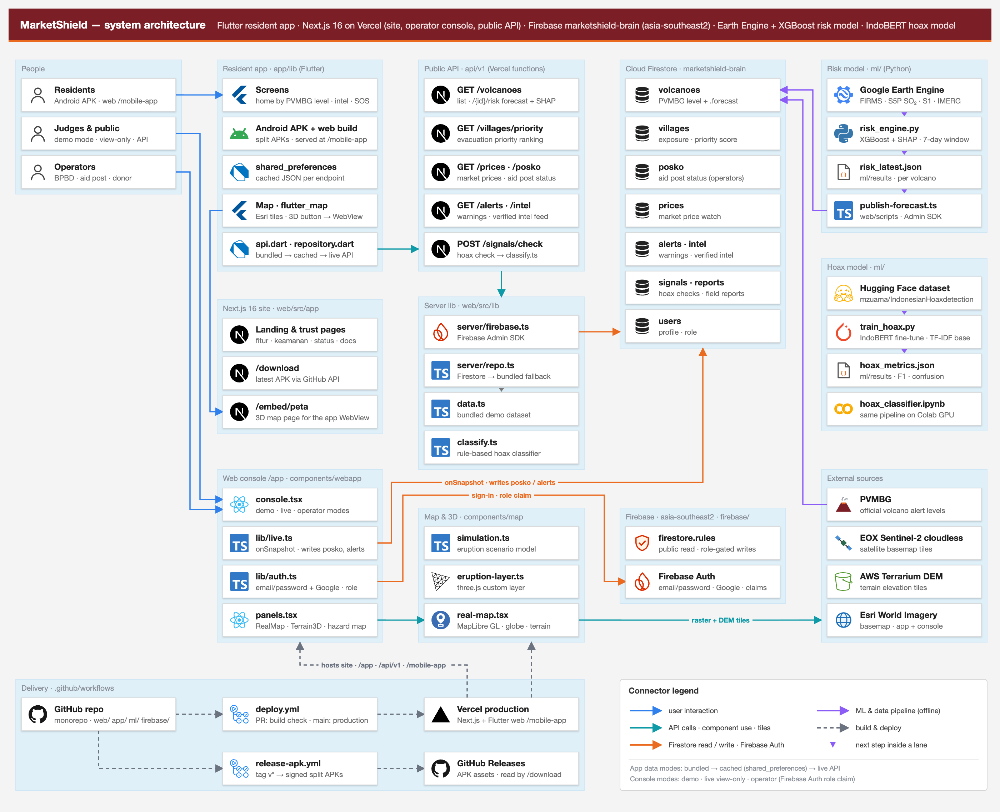
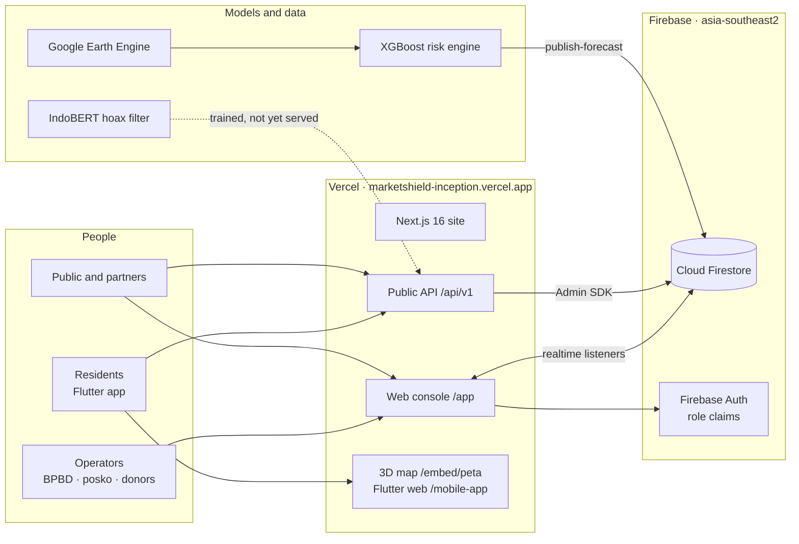

<p align="center">
  
</p>

<div align="center">

# MarketShield

**Gunung dibaca dari orbit. Warga bertindak sebelum panik.**

Satellite-based eruption early warning for residents, markets and aid posts around Indonesia's active volcanoes.

[](https://github.com/aarieffawwaz/marketshield/actions/workflows/deploy.yml)
[](https://github.com/aarieffawwaz/marketshield/actions/workflows/release-apk.yml)
[](https://github.com/aarieffawwaz/marketshield/releases/latest)
[](https://marketshield-inception.vercel.app)
<br/>


*BRAIN – Ayam Jago · BINUS University*

</div>

MarketShield is a disaster-readiness system for communities around Indonesia's active volcanoes. It reads public satellite data from Google Earth Engine, estimates the chance of thermal activity at a volcano in the next 7 days with an XGBoost model, and turns the official PVMBG alert level into one concrete next step for each resident. Residents use a free Flutter app (Android and web). BPBD officers, aid-post coordinators and donors use a Next.js web console. A public REST API exposes the same data. All three read one Cloud Firestore database in Jakarta, so a change made by an aid-post coordinator shows up on every screen within about a second.

> **Prototype.** Volcano levels follow PVMBG; MarketShield forecasts sit next to the official level and never replace it. Villages, aid posts, prices and alerts in the database are seeded demo records shaped like the real pipeline outputs. See [Known limitations](#known-limitations).

## Live links

| | |
|:-|:-|
| **Live site** | <https://marketshield-inception.vercel.app> |
| **Web console (demo)** | <https://marketshield-inception.vercel.app/app/login>: choose *Data contoh* (sample data) or *Data live*, then pick a role. No account needed |
| **Resident app in the browser** | <https://marketshield-inception.vercel.app/mobile> (the same Flutter code as the APK) |
| **Android APK** | [GitHub Releases, latest](https://github.com/aarieffawwaz/marketshield/releases/latest) · [/download](https://marketshield-inception.vercel.app/download) |
| **3D map and eruption simulation** | <https://marketshield-inception.vercel.app/embed/peta?sim=1> |
| **Public API** | <https://marketshield-inception.vercel.app/api/v1/volcanoes> · [API reference](docs/API.md) |
| **System status** | <https://marketshield-inception.vercel.app/status>: live checks from your browser every 30 seconds |
| **Demo video** | ⟨link video demo⟩ |
| **Technical documentation** | [docs/TECHNICAL_DOCUMENTATION.md](docs/TECHNICAL_DOCUMENTATION.md) |

## Preview

<div align="center">

<br/><sub>Console overview in <b>Live</b> mode. The escalation odds come from the XGBoost risk engine through Firestore; the alerts list is the live <code>alerts</code> collection.</sub>
<br/><br/>

<br/><sub>Eruption simulation on Semeru terrain: ash column, distance rings, villages and aid posts in the flow path, and an event log comparing the timeline with and without MarketShield.</sub>
<br/><br/>

<br/><sub>The resident app is the same Flutter code on Android and on the web.</sub>
</div>

<p align="center">
  
  
</p>
<p align="center"><sub>Left: <code>/status</code> checks the API and map providers from the visitor's browser. Right: <code>/api/v1/volcanoes/semeru/risk</code> returns the official level and the model forecast.</sub></p>

## Contents

[Problem](#problem) · [Solution](#solution-four-pillars) · [Features by role](#features-by-role) · [Product tour](#product-tour) · [Architecture](#architecture) · [Technology stack](#technology-stack) · [Models](#models) · [Data sources and licences](#data-sources-and-licences) · [API](#api-reference) · [Repository structure](#repository-structure) · [Getting started](#getting-started) · [Demo mode and live mode](#demo-mode-and-live-mode) · [CI/CD](#cicd) · [Testing](#testing) · [Security](#security) · [Known limitations](#known-limitations) · [Roadmap](#roadmap) · [Team](#team) · [Credits](#credits-and-third-party-licences) · [Documentation](#documentation) · [License](#license)

---

## Problem

Semeru's eruption on 4 December 2021 sent pyroclastic flows down Besuk Kobokan within an afternoon. PVMBG's alert level is precise, but it reaches residents as a status with no instruction attached, and they still have to guess what to do. Around every escalation three things go wrong at the same time:

1. **Rumours travel faster than corrections.** Chain messages on WhatsApp ("lahar has reached Pronojiwo, leave now!") spread panic before anyone can check them.
2. **Prices jump and shelves empty.** Residents buy masks and clean water all at once; pharmacies sell out in a day and get accused of price gouging.
3. **Aid goes to the easiest villages.** Villages closest to the road get supplies first, while the most exposed villages wait.

The people involved are residents of the hazard zones (KRB) around the volcano, BPBD operations officers, aid-post and village coordinators, and local pharmacies and distributors. They work in Bahasa Indonesia, often on low-end phones with weak signal.

## Solution: four pillars

<p align="center">
  
</p>

| Pillar | What it does | Answers |
|:-|:-|:-|
| **1. GeoAI predictive engine** (early action window) | Earth Engine features (NASA FIRMS, Sentinel-5P SO₂, Sentinel-1, GPM IMERG) go into an XGBoost model that gives a 7-day activity probability and its top drivers (SHAP), shown next to the official level | Time to prepare before the level rises |
| **2. Pre-emptive procurement nudge** | At Level II (Waspada) the app asks residents to build their go-kit in stages, by cohort, at price-cap (HET) prices, so demand is spread over days | Panic buying |
| **3. Anti-hoax feed** | Paste a chain message: trigger words, a satellite cross-check and the nearest official fact come back in seconds. IndoBERT is trained (98.4 % test accuracy); the API serves a rule-based classifier for now | Rumours and panic |
| **4. Emergency price tracker** | Market prices compared with the government price cap (HET); deviation above 30 % is flagged | Price speculation |

These reach people through three surfaces: the adaptive resident app, the operator console with the Aid Priority Index, and the public API (8 endpoints under `/api/v1`).

<p align="center">
  
</p>

The resident home screen follows the PVMBG level and always puts one main action at the top: prepare a go-kit at Level I, shop fairly at Level II, know your route at Level III, evacuate at Level IV.

**Where models are used, and where they are not.** Models appear only where a rule cannot do the job: combining many weak satellite signals into one probability, and reading informal Indonesian chain messages. Safety decisions stay official or deterministic.

| Responsibility | Model | Official source or deterministic code |
|:-|:-|:-|
| Volcano alert level | – | PVMBG status, stored as `volcanoes/{id}.level` |
| 7-day activity probability | XGBoost risk engine on Earth Engine features ([report](ml/README.md#2-satellite-risk-engine)) | Shown next to the official level, never replacing it |
| Message check | IndoBERT fine-tuned on 12k Indonesian texts ([report](ml/README.md#1-indobert-hoax-filter)) | Trigger words, satellite cross-check, nearest official fact; the rule-based classifier serves the API and app today |
| Aid priority | – | exposure × hazard × vulnerability ÷ (aid received + 1) |
| Price watch | – | (market − HET) ÷ HET, flagged above 30 % |
| Broadcasts | – | Signed-in BPBD operators only, staggered by cohort |

**Design choices for the people using it.** Plain Bahasa Indonesia first, with English everywhere. Works on a low-end phone and offline, from cached or bundled data. Residents need no account. Safety features are free. No field sensor has to be installed or maintained on an active volcano: every input comes from public satellite catalogues and official sources.

## Features by role

### Residents (warga): Flutter app, Android and web

- **Adaptive home** (*Beranda*): hero, main button and highlighted features change with PVMBG levels I–IV.
- **Hazard map** (*Peta*): KRB rings, ash and lahar areas, evacuation route and shelters (flutter_map); a **3D** button opens the eruption simulation in an in-app WebView.
- **Intel**: paste a chain message to get a label, trigger words, satellite cross-check and nearest official fact; verified intel feed.
- **Posko**: nearest aid posts and shelters with *Buka* / *Penuh* / *Tutup* status, capacity and needs, updated by coordinators.
- **Kit Siaga** with HET price anchors, and a price report form (on screen only in this prototype, nothing is sent yet).
- **Sector protocols**, for example farmers and livestock keepers.
- **SOS**: hold for 3 seconds.
- **Profil**: Indonesian/English, demo or live data, level simulation in demo mode, data sources and photo credits.
- **Offline**: last good data is cached per endpoint; bundled data is used when there is nothing cached. A chip shows *Live*, *Offline · data tersimpan* or *Offline · data bawaan*.
- No account needed.

### Aid-post coordinators (posko): web console

- Sign in with email or Google; role comes from a Firebase custom claim.
- Change an aid post's status (*Buka*, *Penuh*, *Tutup*), occupancy, stock and needs. Firestore rules let this role change only those fields.
- See the overview, hazard map, Aid Priority Index, and alerts and broadcasts.

### BPBD operators: web console

- **Overview**: KPIs, next actions, forecast chart from the risk engine, latest alerts.
- **Hazard map**: satellite 3D, model view and 2D.
- **Aid Priority Index** per village, and logging a delivery (which moves the next delivery to another village).
- **Posts and shelters**: status, capacity, stock.
- **Broadcasts** staggered by cohort so an announcement does not trigger panic buying.
- **Signal filter**: message check and intel feed.
- **Price watch**: HET deviation and history.
- ⌘K command palette, notifications, Indonesian/English, dark mode, guided tour (Driver.js) on the first visit.

### Donors and distributors: web console

- Overview, hazard map, Aid Priority Index and price watch, to see where supplies are needed and prove fair pricing.

### Admins

- Full write access in Firestore rules, including the official volcano level and price caps.
- Assign operator roles with `npm run set-role` (writes the custom claim and `users/{uid}`).
- Load or refresh data with `npm run seed` and publish model forecasts with `npm run publish-forecast`.
- In the console an admin gets the BPBD view.

| Console tab | BPBD | Posko | Donor |
|:-|:-:|:-:|:-:|
| Overview | ✓ | ✓ | ✓ |
| Hazard map | ✓ | ✓ | ✓ |
| Aid priority | ✓ | ✓ | ✓ |
| Posts and shelters | ✓ | ✓ | |
| Alerts and broadcasts | ✓ | ✓ | |
| Signal filter | ✓ | | |
| Price watch | ✓ | | ✓ |

## Product tour

Open **[marketshield-inception.vercel.app](https://marketshield-inception.vercel.app)**.

1. **Watch the volcano.** The landing page opens on a live 3D map. Press **Simulasi erupsi** to see the ash column, the pyroclastic flow down Besuk Kobokan and the villages in its path, with and without MarketShield.
2. **Use the resident app.** Open **[/mobile](https://marketshield-inception.vercel.app/mobile)** or install the APK. Pick *Mode demo* to move the level from I to IV and watch the home screen change, or *Data live* to read the real database. Paste a chain message into **Intel**. Tap **3D** on the map.
3. **Run the console.** Open **[/app/login](https://marketshield-inception.vercel.app/app/login)**, pick **Data contoh** or **Data live**, then enter as BPBD, an aid-post coordinator or a donor. A guided tour starts on the first visit.
4. **Change something for real.** With an operator account, switch an aid post from *Buka* to *Penuh*: every open console updates. See [Demo mode and live mode](#demo-mode-and-live-mode) for how to get operator access.
5. **Check it yourself.** Call the [API](docs/API.md), or open **[/status](https://marketshield-inception.vercel.app/status)**.

| Surface | Route | For |
|:-|:-|:-|
| Landing | `/` | Public, partners, BPBD, donors |
| Web console | `/app` | BPBD operators, aid posts, donors, distributors |
| Resident app | `/mobile`, Android APK | Residents |
| 3D map | `/embed/peta` | Opened from the app's **3D** button |
| Product pages | `/fitur` `/harga` `/docs` `/bantuan` `/kemitraan` `/blog` | Features, pricing, docs, help, partnerships, articles |
| Trust pages | `/tentang` `/pers` `/keamanan` `/status` `/changelog` | About, press kit, security and compliance, live status, release notes |
| Legal | `/privasi` `/syarat` `/kredit` | Privacy (UU PDP 27/2022), terms, photo and data credits |
| Download | `/download` | Latest APK, size and SHA-256 from GitHub Releases |
| API | `/api/v1/*` | [API reference](docs/API.md) |

## Architecture

<p align="center">
  
</p>

Source of the diagram: [docs/diagrams/architecture-detailed.html](docs/diagrams/architecture-detailed.html).

Three surfaces (resident app, console, public API) share one Firestore project in `asia-southeast2` (Jakarta). The website, console and API run on Vercel; the Flutter web build is served from the same domain under `/mobile-app`. The models run offline in Python and their output is published to Firestore with a script, following the contract in [firebase/ML-CONTRACT.md](firebase/ML-CONTRACT.md).

<details>
<summary>Text version (Mermaid)</summary>



</details>

**Key decisions** (reasoning in [Technical §3](docs/TECHNICAL_DOCUMENTATION.md#3-architecture-and-decisions)):

- **Satellites instead of sensors.** Nothing to install, steal or maintain on an active volcano; every input is a public catalogue or an official source.
- **Firestore for a small team.** Realtime listeners give instant aid-post updates without a socket server, and security rules enforce roles in the database, so a UI bug cannot grant write access.
- **One Flutter codebase for Android and web.** Residents install a 20 MB APK; partners open the same app in a browser.
- **Fallback everywhere.** The API, the console and the app all ship bundled data and say when they use it. A disaster app that goes blank when the network drops does more harm than good.
- **Message text is never stored.** Only the label, confidence, trigger words, language and length are logged (UU PDP 27/2022 data minimisation).

## Technology stack

| Layer | Technology | Why |
|:-|:-|:-|
| Resident app | Flutter 3.41, Dart 3.11, flutter_map, http, shared_preferences, url_launcher, webview_flutter, google_fonts | One codebase for Android and web; offline cache; small APK |
| Website and console | Next.js 16 (App Router, Turbopack), React 19, TypeScript, Tailwind CSS 4, Motion, Zustand, Recharts, Driver.js, lucide-react | Static marketing pages, client console, Indonesian/English, dark mode |
| Maps and 3D | MapLibre GL 6.16, three.js 0.186 | Globe projection, terrain, custom WebGL layer for the eruption |
| Backend | Next.js route handlers on Vercel, Firebase Admin SDK | Public API next to the site, no separate server to run |
| Database and auth | Cloud Firestore (Jakarta), Firebase Auth (email/password, Google), security rules with custom claims | Realtime, role claims, data close to users |
| Satellite data | Google Earth Engine (10 datasets, Python `earthengine-api`) | Public catalogues, national coverage |
| Machine learning | XGBoost, SHAP, scikit-learn, pandas; PyTorch, Hugging Face Transformers and Datasets, IndoBERT (`indobenchmark/indobert-base-p1`); Google Colab | Tabular risk model with explanations; Indonesian language model |
| Delivery | GitHub Actions, Vercel CLI, GitHub Releases | Build check per PR, production on merge, signed APKs per tag |
| Testing | `flutter test`, `flutter analyze`, ESLint, TypeScript strict, Playwright (browser checks) | See [Testing](#testing) |

## Models

Both models are trained and evaluated in [`ml/`](ml/README.md). Every number below comes from the JSON files in [`ml/results/`](ml/results).

### Satellite risk engine (XGBoost + SHAP)

**Target.** Whether NASA FIRMS records at least one thermal hotspot within 5 km of the summit in the next 7 days. PVMBG's alert-level history is not available in machine-readable form, so the model predicts this satellite proxy for eruptive activity. **It is not the PVMBG level**, and the app always shows the official level separately.

**Data.** Weekly Google Earth Engine features for 25 volcanoes, January 2019 to October 2026: 407 weeks, 10,067 volcano-weeks. Features: FIRMS hotspot fraction (this week and the previous 3 weeks), Sentinel-5P SO₂ and its trend, Sentinel-1 VV backscatter change, GPM IMERG rainfall.

**Method.** XGBoost (300 trees, depth 4, class-weighted). Time split: train 2019–2023 (6,416 rows), test 2024–2026 (3,651 rows). Baseline: persistence ("next week looks like this week").

| Metric (test 2024–2026) | XGBoost | Persistence baseline |
|:-|:-:|:-:|
| ROC-AUC | **0.899** | 0.784 |
| PR-AUC | **0.674** | 0.455 |
| Recall | **78 %** | 63 % |
| Precision | 55 % | 63 % |
| F1 | **0.649** | 0.633 |
| Onset weeks (no hotspot this week): ROC-AUC / recall | **0.81 / 45 %** | cannot predict onsets |

SHAP ranking: hotspots in the previous 3 weeks, hotspots this week, SO₂, rainfall, Sentinel-1 backscatter, SO₂ trend. The newest forecast per volcano is written to `volcanoes/{id}.forecast` by `web/scripts/publish-forecast.ts`; the console and `/api/v1/volcanoes/{id}/risk` read it.

### IndoBERT hoax filter

**Data.** [`mzuama/IndonesianHoaxdetection`](https://huggingface.co/datasets/mzuama/IndonesianHoaxdetection): 12,150 texts, 12,136 after removing empty rows and duplicates **before** splitting. Stratified 80/10/10 split (9,708 / 1,214 / 1,214). Fine-tuned `indobenchmark/indobert-base-p1` for 2 epochs with short-crop augmentation and 60 team-written short disaster messages (training only).

| Evaluation set | n | TF-IDF + LogReg | IndoBERT |
|:-|:-:|:-:|:-:|
| Test (article-length texts) | 1,214 | 96.9 % | **98.4 %** (macro-F1 0.984) |
| Test, short crops (first 8–30 words) | 1,208 | 94.8 % | **96.6 %** |
| Test, disaster-related subset | 70 | 98.6 % | **100 %** |
| Probe: short WhatsApp-style disaster messages | 40 | 87.5 % | **90.0 %** |

The first run scored 98.3 % on the test split but only 50 % on the 40-message probe set, because it labelled every short message as a hoax. Short-crop augmentation and the team-written messages brought the probe to 90 %. The probe set was written by the team, so treat it as a sanity check, not a benchmark.

**In the product.** A 500 MB model does not fit a serverless function, so `/api/v1/signals/check` still uses the rule-based classifier in `web/src/lib/classify.ts` (`rules-v1`). Serving IndoBERT behind the same response contract is the next step.

<p align="center">
  
  
</p>

Training details, discarded runs and reproduction commands: [ml/README.md](ml/README.md).

## Data sources and licences

| Source | Used for | Licence / terms |
|:-|:-|:-|
| Google Earth Engine: NASA FIRMS, Sentinel-5P SO₂ and aerosol (`COPERNICUS/S5P`), Sentinel-1 GRD | Risk engine features, hazard layers | Copernicus open licence, NASA open data, Earth Engine terms (project registered for non-commercial use) |
| Google Earth Engine: GPM IMERG, NOAA GFS | Rainfall (rain-lahar risk), wind (ash drift) | NASA / NOAA open data |
| Google Earth Engine: Sentinel-2, MODIS, Landsat 9, Copernicus DEM GLO-30 | Vegetation change, land-surface temperature, terrain | Copernicus open licence, NASA / USGS open data |
| Google Earth Engine: WorldPop, ESA WorldCover | Exposed population, land cover | CC BY 4.0 |
| PVMBG / MAGMA Indonesia | Official volcano levels | Public government information |
| Government price caps (HET) | Price watch reference | Public regulations |
| `mzuama/IndonesianHoaxdetection` (Hugging Face) | IndoBERT training and evaluation | Licence not stated by the author |
| Sentinel-2 cloudless 2023 by EOX | Map imagery | CC BY-NC-SA 4.0 (**non-commercial**) |
| AWS Terrain Tiles (Terrarium) | 3D terrain | Open data |
| Esri basemaps | Map basemap | Esri terms of use |
| OpenStreetMap | Map data | ODbL |
| Natural Earth | Land outline for the globe | Public domain |

The full list, including photos, 3D models, fonts and libraries, is in [docs/AI_USE_AND_THIRD_PARTY.md](docs/AI_USE_AND_THIRD_PARTY.md).

## API reference

Base URL: `https://marketshield-inception.vercel.app/api/v1`. JSON over HTTPS, no authentication, CORS open (`Access-Control-Allow-Origin: *`). Every response includes `source`: `"firestore"` when served from the live database, `"static"` when the bundled dataset was used.

| Method | Path | Returns |
|:-|:-|:-|
| GET | `/volcanoes` | 25 mapped volcanoes with the official PVMBG level |
| GET | `/volcanoes/{id}/risk` | Official level, scenario escalation probability, action window, satellite indicators and the latest model forecast (`model`) |
| GET | `/villages/priority?level=&volcano=` | Aid Priority Index ranking |
| GET | `/prices` | Emergency goods: HET, market average, deviation, `flagged` above 0.3 |
| GET | `/posko?volcano=` | Aid posts and shelters: status, capacity, stock, needs |
| GET | `/alerts` | Latest alerts from BPBD and satellites (newest 20) |
| GET | `/intel` | Verified claims: hoax, panic, verified, official |
| POST | `/signals/check` | Classify a chain message (`{ "text": "...", "lang": "id" }`) and cross-check it; the text is never stored |

```bash
curl https://marketshield-inception.vercel.app/api/v1/volcanoes/semeru/risk

curl -X POST https://marketshield-inception.vercel.app/api/v1/signals/check \
  -H 'Content-Type: application/json' \
  -d '{"text":"Katanya lahar sudah masuk Pronojiwo, segera tinggalkan rumah! Sebarkan!"}'
```

Parameters, sample responses and error codes: [docs/API.md](docs/API.md).

## Repository structure

```
marketshield/
├── app/                        Flutter resident app (Android + web)
│   ├── lib/
│   │   ├── main.dart, core.dart    entry point; bundled models and demo data
│   │   ├── data/                   api.dart, repository.dart (cache → fallback), mappers.dart, credits.dart
│   │   ├── screens/                shell, map, map3d, intel, posko, sector, sos, profile, onboarding, credits
│   │   └── geo_map.dart            flutter_map hazard map (KRB rings, ash, lahar, routes, posts)
│   ├── android/                Gradle; release signing from key.properties (CI only)
│   └── test/                   data_test.dart, widget_test.dart
├── web/                        Next.js 16 site, console and public API
│   ├── src/app/                routes: /, /app, /mobile, /embed/peta, /download, product, trust and legal pages
│   │   └── api/v1/             route handlers for the public API
│   ├── src/components/         landing, map (MapLibre + three.js), webapp (console), pages, site, ui
│   ├── src/lib/                data.ts, classify.ts, live.ts, auth.ts, store.ts, release.ts, server/ (Admin SDK)
│   ├── scripts/                seed.ts, set-role.ts, publish-forecast.ts
│   └── .env.example
├── ml/                         Models: risk_engine.py, train_hoax.py, hoax_classifier.ipynb, data/, results/
├── firebase/                   firestore.rules, firestore.indexes.json, SCHEMA.md, ML-CONTRACT.md
├── docs/                       technical docs, API, security, evidence, diagrams, README images
├── .github/workflows/          deploy.yml, release-apk.yml
├── firebase.json
└── CHANGELOG.md
```

## Getting started

**Requirements**

| Part | Needs |
|:-|:-|
| Website, console, API | Node.js 20+ and npm |
| Resident app | Flutter 3.41 stable (CI uses 3.41.6); Android SDK for device builds; Java 17 for release APKs |
| Firebase rules | Firebase CLI (`npm install -g firebase-tools`), optional |
| Models | Python 3 with pip; an Earth Engine–registered Google Cloud project for the risk engine; a GPU helps for IndoBERT |

Nothing below needs a secret unless you want live data. Without credentials every surface serves the bundled demo dataset.

### Web (site, console, API)

```bash
git clone https://github.com/aarieffawwaz/marketshield.git
cd marketshield/web
npm install          # also copies the MapLibre worker into public/vendor
npm run dev          # http://localhost:3000, serves bundled demo data
npm run lint         # ESLint
npm run build        # production build
```

**Environment variables.** The only server variable is listed in [`web/.env.example`](web/.env.example):

| Variable | Purpose |
|:-|:-|
| `FIREBASE_SERVICE_ACCOUNT` | Service-account JSON (raw or base64) for the Firebase Admin SDK. Leave empty to serve bundled demo data. |

```bash
cp .env.example .env.local     # used by `npm run dev`; never commit it (.env* is git-ignored)
```

The browser-side Firebase config in `web/src/lib/firebase-config.ts` is public by design and its key is restricted to the project's domains. To run against your own Firebase project, replace that config and use a service account from your project.

**Admin scripts** read `FIREBASE_SERVICE_ACCOUNT` from the shell:

```bash
export FIREBASE_SERVICE_ACCOUNT="$(cat path/to/your-service-account.json)"
npm run seed                                   # load the demo dataset into Firestore (idempotent)
npm run set-role -- operator@example.org bpbd "Nama Operator" "BPBD Kab. Lumajang"
npm run publish-forecast -- ../ml/results/risk_latest.json
```

`set-role` accepts the roles `admin`, `bpbd`, `posko` and `donor`. Passing `google` as a fifth argument creates a Google-only account.

### Resident app (Flutter)

```bash
cd app
flutter pub get
flutter analyze
flutter test
flutter run                     # Android device or emulator
flutter run -d chrome           # web; add ?mode=demo or ?mode=live
```

To serve the app at `/mobile` locally:

```bash
flutter build web --release --base-href /mobile-app/ --no-web-resources-cdn
cp -R build/web/. ../web/public/mobile-app/
```

Android builds: `flutter build apk --release --split-per-abi`. Without `android/key.properties` the build falls back to the debug key; release signing happens in CI.

### Firebase (rules and indexes)

`firebase.json` points the Firebase CLI at `firebase/firestore.rules` and `firebase/firestore.indexes.json`.

```bash
firebase login
firebase deploy --only firestore:rules,firestore:indexes --project <your-project-id>
```

To try the rules locally, `firebase emulators:start --only firestore --project demo-marketshield` starts the Firestore emulator with the same rules file. The web and app code are not wired to the emulator, so this is only useful for testing rules. Collections and fields are documented in [firebase/SCHEMA.md](firebase/SCHEMA.md).

### Models (Python)

```bash
cd ml
python3 -m venv .venv && source .venv/bin/activate
pip install -r requirements.txt

# IndoBERT hoax filter (about 21 min on an Apple M5 GPU, about 10 min on a Colab T4)
python train_hoax.py --epochs 2 --crop-aug --domain-aug --out results

# Satellite risk engine (needs Earth Engine access)
pip install earthengine-api xgboost shap
gcloud auth application-default login \
  --scopes=https://www.googleapis.com/auth/earthengine,https://www.googleapis.com/auth/cloud-platform
python risk_engine.py --project <your-gcp-project> --out results
```

The hoax notebook [`ml/hoax_classifier.ipynb`](ml/hoax_classifier.ipynb) runs the same pipeline in Colab. Keys for notebooks go in Colab Secrets, never in cells ([firebase/ML-CONTRACT.md](firebase/ML-CONTRACT.md)).

## Demo mode and live mode

<p align="center">
  
</p>

| Mode | How to get it | Data | Writes |
|:-|:-|:-|:-|
| **Demo** | Console: *Data contoh* + a quick role. App: *Mode demo* or `?mode=demo` | Bundled scenario | Stay on screen only, never saved |
| **Live, view only** | Console: *Data live* + a quick role, or a Google account without a role. App: *Data live* or `?mode=live` | Firestore in realtime | Refused with a message |
| **Live, operator** | Sign in with an operator account (email or Google) that has a role claim | Firestore in realtime | Saved, and checked by Firestore rules |

A badge on every screen shows which mode is active. Live never goes blank: the app falls back to the last cached data, then to bundled data, and says so in the header (*Offline · data tersimpan 14.05*).

**Operator access for a demo.** Demo and live view-only modes need no account and show every screen. To try a real write (for example switching an aid post to *Penuh*), contact the team through the [repository owner's GitHub profile](https://github.com/aarieffawwaz) and we will create an operator account for you. Credentials are never published in this repository. If you run your own copy, create operators with `npm run set-role`.

## CI/CD

<p align="center">
  
</p>

| Trigger | Workflow | What happens |
|:-|:-|:-|
| Pull request | [`deploy.yml`](.github/workflows/deploy.yml) | Flutter web build copied into `web/public/mobile-app`, then `vercel build` as a check. Nothing is uploaded |
| Merge to `main` | [`deploy.yml`](.github/workflows/deploy.yml) | Same build, then `vercel deploy --prebuilt --prod` to production |
| Tag `v*` | [`release-apk.yml`](.github/workflows/release-apk.yml) | Signed arm64 and armv7 APKs, `SHA256SUMS.txt`, GitHub Release with generated notes |

PR previews were switched to build-only after they used up Vercel's free daily upload quota. To release the app, bump `version` in `app/pubspec.yaml`, then `git tag vX.Y.Z && git push --tags`; [/download](https://marketshield-inception.vercel.app/download) reads the latest release from the GitHub API.

Repository secrets (names only): `VERCEL_TOKEN`, `VERCEL_ORG_ID`, `VERCEL_PROJECT_ID`, `ANDROID_KEYSTORE_BASE64`, `ANDROID_KEYSTORE_PASSWORD`, `ANDROID_KEY_ALIAS`, `ANDROID_KEY_PASSWORD`. Vercel holds `FIREBASE_SERVICE_ACCOUNT`.

## Testing

| Check | How | Result |
|:-|:-|:-|
| Flutter | `flutter analyze`, `flutter test` | No issues; 7 tests pass (data mapping and widgets) |
| Web | TypeScript strict, `npm run lint`, `npm run build` (also run on every PR) | Builds in CI |
| Page audit | Playwright, 23 routes at 1440 px and 390 px | No console errors, no horizontal overflow, no broken images after three fixes |
| Firestore rules, anonymous client | REST reads per collection | Public collections 200; `signals`, `reports`, `users` 403 |
| Operator write, end to end | Posko coordinator signs in and changes *Posko Pronojiwo* | Firestore updated, then reverted |
| Demo and live view-only | Same change in both modes | Demo stays on screen; view-only is refused; Firestore untouched |
| Live API | All 7 GET endpoints in production | Served from Firestore; risk endpoint includes the model forecast |
| Models | Held-out test sets, time split for the risk engine | See [Models](#models) |
| APK integrity | SHA-256 per release | `SHA256SUMS.txt` in each release and on `/download` |

Commands, timestamps, sample responses and a screenshot gallery (Firebase, Earth Engine, Colab, Vercel, GitHub): [docs/EXECUTION_EVIDENCE.md](docs/EXECUTION_EVIDENCE.md).

<p align="center">
  
  
  
  
  
  
</p>

## Security

- **Roles are enforced by the database.** Firestore rules allow public reads only for reference data. Aid-post coordinators can change only status fields; `signals`, `reports` and `users` are private. Checked from an anonymous client: `volcanoes` 200, `signals` 403.
- **The browser session is never trusted.** The console session in `localStorage` only controls the UI; every write is checked by Firestore against the ID token's custom claim.
- **Least-privilege keys.** The API's service account has Datastore User and Firebase Auth Admin only; notebooks use a separate Datastore-only account. The browser key is restricted to the project's domains.
- **Data minimisation (UU PDP 27/2022).** The hoax check stores label, confidence and trigger words, never the message text. The resident app works without an account.
- **Secrets stay out of git.** Keys live in GitHub and Vercel secrets; `.env*`, keystores, `key.properties` and AI helper files are git-ignored. APKs from v1.0.1 are signed with a release key kept outside the repository.

Open items include per-post scoping for the `posko` role and a rate limit on `POST /signals/check`. The full self-assessment, including a notebook key that was exposed and disabled during development, is in [docs/SECURITY_SELF_ASSESSMENT.md](docs/SECURITY_SELF_ASSESSMENT.md). Report vulnerabilities privately through [GitHub Security Advisories](https://github.com/aarieffawwaz/marketshield/security/advisories/new).

## Known limitations

- **Seeded operational data.** Villages, aid posts, prices, alerts and intel are realistic demo records in Firestore. They are not yet fed by BPBD or market surveys.
- **The risk target is a proxy.** The risk engine predicts NASA FIRMS thermal activity within 5 km of the summit in the next 7 days, because PVMBG level history is not machine-readable. It is not the PVMBG alert level, and without seismic data a sudden eruption can be missed. PVMBG stays the official reference.
- **Models run offline.** The risk engine and IndoBERT are trained and evaluated in `ml/`, and the forecast is published to Firestore with a script. The 6-hourly schedule is not set up yet, and the message check in the API and app still uses the rule-based classifier.
- **The hoax dataset is news-style.** Real WhatsApp messages are shorter and messier; the 40-message probe set was written by the team and is a sanity check only.
- **One volcano in depth.** Semeru has full detail (villages, posts, risk); the other 24 mapped volcanoes have hazard rings only.
- **No push notifications yet.** Broadcasts appear in the console and the app feed; FCM delivery is planned.
- **The price report form in the app is UI only.** Reports are not sent to the server yet.
- **Android only for the native app.** iOS and the Play Store are planned. v1.0.0 was signed with a debug key; later releases use the release key, so v1.0.0 testers reinstall once.
- **Non-commercial imagery.** EOX Sentinel-2 cloudless (CC BY-NC-SA 4.0) and the Earth Engine registration are non-commercial; a paid service needs commercial imagery and an Earth Engine commercial licence.
- **Self-assessed security.** No third-party audit; open findings are listed in [the self-assessment](docs/SECURITY_SELF_ASSESSMENT.md#4-findings).

## Roadmap

1. Schedule the Earth Engine feature pipeline and the risk model every 6 hours (GitHub Actions and a service account).
2. Serve the fine-tuned IndoBERT model behind `/api/v1/signals/check`, keeping the same response contract.
3. FCM push notifications, sent in cohorts so broadcasts do not trigger panic buying.
4. Pilot with one village on Semeru's slopes and BPBD Lumajang (proposed: Kecamatan Candipuro), with real aid-post and price data; measure a baseline before claiming impact.
5. Retrain the risk engine on official escalations once machine-readable PVMBG level history is available.
6. Play Store release (PSE registration under PP 71/2019) and an iOS build, then the next volcanoes.
7. **SAR-Vault (research idea, not built):** an IoT supply box with a smart lock for distribution without hoarding.

## Team

**BRAIN – Ayam Jago**, BINUS University

| Member | Role | Worked on |
|:-|:-|:-|
| Hansel Mitchell T. | Data and AI engineer | Google Earth Engine pipeline, risk engine, IndoBERT |
| Aarief Fawwaz S. | Mobile and cloud engineer | Flutter app, Next.js console and API, Firebase, deployment |

## Credits and third-party licences

The full declaration, with licences for every dataset, map service, photo, 3D model, font and library, is in **[docs/AI_USE_AND_THIRD_PARTY.md](docs/AI_USE_AND_THIRD_PARTY.md)**. In short:

**AI inside the product**

| Component | Model | Status |
|:-|:-|:-|
| Risk engine | XGBoost + SHAP, trained by the team on Earth Engine features for 25 volcanoes (2019–2026); target is NASA FIRMS thermal activity in the next 7 days | ROC-AUC 0.899 vs 0.784 baseline on 2024–2026; forecast in `volcanoes/{id}.forecast` |
| Hoax filter | IndoBERT (`indobenchmark/indobert-base-p1`, MIT) fine-tuned by the team on `mzuama/IndonesianHoaxdetection` plus 60 team-written short disaster messages | 98.4 % test accuracy, 90 % on a 40-message probe set; not served yet |
| Rule-based classifier | Trigger phrases and satellite cross-check (`web/src/lib/classify.ts`) | In production |

**AI used to build the product**

| Tool | Used for |
|:-|:-|
| Claude Code (Anthropic) | Writing and refactoring code for the website, console, API, Flutter app and CI; debugging; automated browser checks; writing documentation and drawing its diagrams. The team reviewed, tested and merged every change through pull requests. |

**Third-party data, services and assets**

- **Satellite and geospatial data:** Google Earth Engine catalogue (Sentinel-1, Sentinel-2, Sentinel-5P, NASA FIRMS, MODIS, Landsat 9, GPM IMERG, NOAA GFS, Copernicus DEM, WorldPop, ESA WorldCover).
- **Official information:** PVMBG / MAGMA Indonesia volcano levels; government price caps (HET).
- **Map tiles:** Sentinel-2 cloudless by EOX (CC BY-NC-SA 4.0, non-commercial), AWS Terrain Tiles, Esri basemaps, © OpenStreetMap contributors (ODbL), Natural Earth.
- **Photos:** Wikimedia Commons and BNPB, each with author and licence in [`web/src/lib/photo-credits.json`](web/src/lib/photo-credits.json) and on [/kredit](https://marketshield-inception.vercel.app/kredit).
- **3D models:** NVIDIA SimReady Assets (CC BY 4.0).
- **Logos:** agency and brand marks identify data sources and target users only; no partnership is implied. Brand icons from Simple Icons (CC0).
- **Fonts:** Poppins, Geist, Geist Mono and Google Fonts in the app (SIL Open Font License 1.1).
- **Open-source libraries:** MIT, Apache-2.0, BSD or ISC licensed, plus GSAP under its own free standard licence.

## Documentation

| Document | Contents |
|:-|:-|
| [Technical documentation](docs/TECHNICAL_DOCUMENTATION.md) | Architecture and decisions, app, console, backend, data model, models, deployment, operations |
| [API reference](docs/API.md) | Every endpoint with parameters and sample responses |
| [ML report](ml/README.md) | Training data, method, results and reproduction for both models |
| [Security self-assessment](docs/SECURITY_SELF_ASSESSMENT.md) | Threat model, controls, findings and their status |
| [Execution evidence](docs/EXECUTION_EVIDENCE.md) | What was run, when, what it returned, and a screenshot gallery |
| [AI use and third parties](docs/AI_USE_AND_THIRD_PARTY.md) | Full declaration with licences |
| [Firestore schema](firebase/SCHEMA.md) · [ML data contract](firebase/ML-CONTRACT.md) | Collections, fields and roles; how notebooks write |
| [Changelog](CHANGELOG.md) | Release history |

## License

Source code: all rights reserved by the team until an open-source licence is chosen. Third-party data, photos, models and libraries keep their own licences (see [Credits and third-party licences](#credits-and-third-party-licences)).
