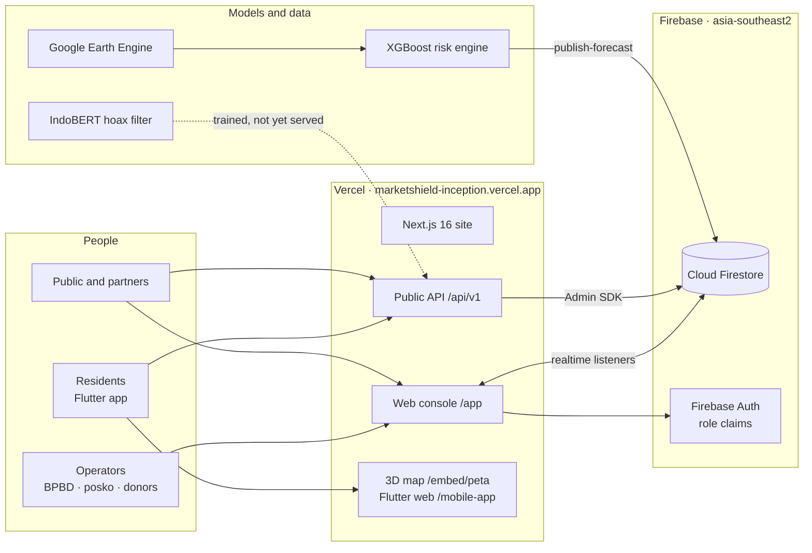

<p align="center">
  
</p>

<div align="center">

# MarketShield

**Gunung dibaca dari orbit. Warga bertindak sebelum panik.**

Peringatan dini erupsi berbasis satelit untuk warga, pasar, dan posko bantuan di sekitar gunung api aktif Indonesia.

**Bahasa Indonesia** · [English](README.en.md)

[](https://github.com/aarieffawwaz/marketshield/actions/workflows/deploy.yml)
[](https://github.com/aarieffawwaz/marketshield/actions/workflows/release-apk.yml)
[](https://github.com/aarieffawwaz/marketshield/releases/latest)
[](https://marketshield-inception.vercel.app)
<br/>


*BRAIN – Ayam Jago · BINUS University*

</div>

MarketShield adalah sistem kesiapsiagaan bencana untuk masyarakat di sekitar gunung api aktif Indonesia. Sistem ini membaca data satelit publik dari Google Earth Engine, memperkirakan peluang aktivitas termal di sebuah gunung api dalam 7 hari ke depan dengan model XGBoost, lalu menerjemahkan level status resmi PVMBG menjadi satu langkah konkret untuk setiap warga. Warga memakai aplikasi Flutter gratis (Android dan web). Petugas BPBD, koordinator posko, dan donatur memakai konsol web Next.js. REST API publik menyediakan data yang sama. Ketiganya membaca satu database Cloud Firestore di Jakarta, sehingga perubahan yang dibuat koordinator posko muncul di semua layar dalam waktu sekitar satu detik.

> **Prototipe.** Level gunung api mengikuti PVMBG. Prakiraan MarketShield ditampilkan di samping level resmi dan tidak pernah menggantikannya. Data desa, posko, harga, dan peringatan di database adalah data demo yang bentuknya mengikuti output pipeline yang sebenarnya. Lihat [Keterbatasan saat ini](#keterbatasan-saat-ini).

## Tautan

| | |
|:-|:-|
| **Situs live** | <https://marketshield-inception.vercel.app> |
| **Konsol web (demo)** | <https://marketshield-inception.vercel.app/app/login>: pilih *Data contoh* atau *Data live*, lalu pilih peran. Tidak perlu akun |
| **Aplikasi warga di browser** | <https://marketshield-inception.vercel.app/mobile> (kode Flutter yang sama dengan APK) |
| **APK Android** | [GitHub Releases, versi terbaru](https://github.com/aarieffawwaz/marketshield/releases/latest) · [/download](https://marketshield-inception.vercel.app/download) |
| **Peta 3D dan simulasi erupsi** | <https://marketshield-inception.vercel.app/embed/peta?sim=1> |
| **API publik** | <https://marketshield-inception.vercel.app/api/v1/volcanoes> · [Referensi API](docs/API.md) |
| **Status sistem** | <https://marketshield-inception.vercel.app/status>: pengecekan live dari browser Anda setiap 30 detik |
| **Video demo** | <https://youtu.be/oceCSCnBmjg> |
| **Pitch deck** | [Folder Google Drive](https://drive.google.com/drive/folders/1ypw_RPtIklhbmFj5fhVZ3T04-rk1DNi-?usp=sharing) |
| **Dokumentasi teknis** | [docs/TECHNICAL_DOCUMENTATION.md](docs/TECHNICAL_DOCUMENTATION.md) |

## Pratinjau

<div align="center">

<br/><sub>Ringkasan konsol dalam mode <b>Live</b>. Peluang eskalasi berasal dari mesin risiko XGBoost lewat Firestore; daftar peringatan diambil langsung dari koleksi <code>alerts</code>.</sub>
<br/><br/>

<br/><sub>Simulasi erupsi di terrain Semeru: kolom abu, cincin jarak, desa dan posko di jalur aliran, serta log kejadian yang membandingkan timeline dengan dan tanpa MarketShield.</sub>
<br/><br/>

<br/><sub>Aplikasi warga memakai kode Flutter yang sama di Android dan di web.</sub>
</div>

<p align="center">
  
  
</p>
<p align="center"><sub>Kiri: <code>/status</code> mengecek API dan penyedia peta dari browser pengunjung. Kanan: <code>/api/v1/volcanoes/semeru/risk</code> mengembalikan level resmi dan prakiraan model.</sub></p>

## Daftar isi

[Masalah](#masalah) · [Solusi](#solusi-empat-pilar) · [Fitur per peran](#fitur-per-peran) · [Tur produk](#tur-produk) · [Arsitektur](#arsitektur) · [Stack teknologi](#stack-teknologi) · [Model](#model) · [Sumber data dan lisensi](#sumber-data-dan-lisensi) · [API](#referensi-api) · [Struktur repositori](#struktur-repositori) · [Cara menjalankan](#cara-menjalankan) · [Mode demo dan mode live](#mode-demo-dan-mode-live) · [CI/CD](#cicd) · [Pengujian](#pengujian) · [Keamanan](#keamanan) · [Keterbatasan](#keterbatasan-saat-ini) · [Roadmap](#roadmap) · [Tim](#tim) · [Kredit](#kredit-dan-lisensi-pihak-ketiga) · [Dokumentasi](#dokumentasi) · [Lisensi](#lisensi)

---

## Masalah

Erupsi Semeru pada 4 Desember 2021 mengirim awan panas guguran ke Besuk Kobokan hanya dalam satu sore. Level status PVMBG sudah tepat, tetapi informasi itu sampai ke warga sebagai status tanpa instruksi, sehingga warga masih harus menebak apa yang perlu dilakukan. Setiap kali level naik, ada tiga masalah yang muncul bersamaan:

1. **Rumor menyebar lebih cepat daripada klarifikasi.** Pesan berantai di WhatsApp ("lahar sudah sampai Pronojiwo, segera pergi!") memicu panik sebelum ada yang sempat mengeceknya.
2. **Harga melonjak dan stok habis.** Warga membeli masker dan air bersih secara bersamaan; apotek kehabisan stok dalam sehari lalu dituduh menaikkan harga.
3. **Bantuan menumpuk di desa yang paling mudah dijangkau.** Desa yang paling dekat dengan jalan menerima bantuan lebih dulu, sementara desa yang paling terpapar harus menunggu.

Pihak yang terlibat adalah warga kawasan rawan bencana (KRB) di sekitar gunung, petugas operasional BPBD, koordinator posko dan desa, serta apotek dan distributor lokal. Mereka bekerja dalam Bahasa Indonesia, sering dengan ponsel kelas bawah dan sinyal yang lemah.

## Solusi: empat pilar

<p align="center">
  
</p>

| Pilar | Fungsinya | Masalah yang dijawab |
|:-|:-|:-|
| **1. Mesin prediksi GeoAI** (jendela aksi dini) | Fitur Earth Engine (NASA FIRMS, Sentinel-5P SO₂, Sentinel-1, GPM IMERG) masuk ke model XGBoost yang menghasilkan probabilitas aktivitas 7 hari beserta faktor pendorong utamanya (SHAP), ditampilkan di samping level resmi | Waktu untuk bersiap sebelum level naik |
| **2. Dorongan belanja lebih awal** | Pada Level II (Waspada) aplikasi mengajak warga menyiapkan tas siaga secara bertahap, per kelompok (cohort), dengan harga sesuai HET, sehingga permintaan tersebar dalam beberapa hari | Panic buying |
| **3. Feed anti-hoaks** | Tempel pesan berantai, lalu dalam hitungan detik muncul kata pemicu, cek silang satelit, dan fakta resmi terdekat. IndoBERT sudah dilatih (akurasi uji 98,4%); untuk saat ini API memakai classifier berbasis aturan | Rumor dan panik |
| **4. Pemantau harga darurat** | Harga pasar dibandingkan dengan harga eceran tertinggi (HET) pemerintah; selisih di atas 30% ditandai | Spekulasi harga |

Semua ini sampai ke pengguna lewat tiga tampilan: aplikasi warga yang adaptif, konsol operator dengan Aid Priority Index, dan API publik (8 endpoint di bawah `/api/v1`).

<p align="center">
  
</p>

Beranda aplikasi warga mengikuti level PVMBG dan selalu menaruh satu aksi utama di bagian atas: siapkan tas siaga di Level I, belanja secukupnya di Level II, kenali jalur evakuasi di Level III, dan evakuasi di Level IV.

**Di mana model dipakai, dan di mana tidak.** Model hanya dipakai untuk pekerjaan yang tidak bisa diselesaikan dengan aturan: menggabungkan banyak sinyal satelit yang lemah menjadi satu probabilitas, dan membaca pesan berantai berbahasa Indonesia informal. Keputusan keselamatan tetap berasal dari sumber resmi atau logika deterministik.

| Tanggung jawab | Model | Sumber resmi atau kode deterministik |
|:-|:-|:-|
| Level status gunung api | – | Status PVMBG, disimpan sebagai `volcanoes/{id}.level` |
| Probabilitas aktivitas 7 hari | Mesin risiko XGBoost dengan fitur Earth Engine ([laporan](ml/README.md#2-satellite-risk-engine)) | Ditampilkan di samping level resmi dan tidak menggantikannya |
| Cek pesan | IndoBERT yang di-fine-tune dengan 12 ribu teks berbahasa Indonesia ([laporan](ml/README.md#1-indobert-hoax-filter)) | Kata pemicu, cek silang satelit, fakta resmi terdekat; saat ini API dan aplikasi memakai classifier berbasis aturan |
| Prioritas bantuan | – | keterpaparan × bahaya × kerentanan ÷ (bantuan yang sudah diterima + 1) |
| Pantauan harga | – | (harga pasar − HET) ÷ HET, ditandai jika di atas 30% |
| Siaran | – | Hanya operator BPBD yang sudah login, dikirim bertahap per kelompok |

**Pilihan desain untuk penggunanya.** Bahasa Indonesia yang sederhana menjadi bahasa utama, dengan versi bahasa Inggris di semua bagian. Bisa dipakai di ponsel kelas bawah dan secara offline, memakai data cache atau data bawaan. Warga tidak perlu akun. Fitur keselamatan gratis. Tidak ada sensor lapangan yang harus dipasang atau dirawat di gunung api aktif: semua input berasal dari katalog satelit publik dan sumber resmi.

## Fitur per peran

### Warga: aplikasi Flutter, Android dan web

- **Beranda adaptif** (*Beranda*): hero, tombol utama, dan fitur yang disorot berubah mengikuti level PVMBG I–IV.
- **Peta bahaya** (*Peta*): cincin KRB, area abu dan lahar, jalur evakuasi, dan tempat pengungsian (flutter_map); tombol **3D** membuka simulasi erupsi di WebView dalam aplikasi.
- **Intel**: tempel pesan berantai untuk mendapatkan label, kata pemicu, cek silang satelit, dan fakta resmi terdekat; tersedia juga feed intel yang sudah diverifikasi.
- **Posko**: posko dan tempat pengungsian terdekat dengan status *Buka* / *Penuh* / *Tutup*, kapasitas, dan kebutuhan, yang diperbarui oleh koordinator.
- **Kit Siaga** dengan acuan harga HET, serta formulir laporan harga (di prototipe ini hanya tampil di layar, belum ada data yang dikirim).
- **Protokol per sektor**, misalnya untuk petani dan peternak.
- **SOS**: tahan selama 3 detik.
- **Profil**: Bahasa Indonesia/Inggris, data demo atau live, simulasi level di mode demo, sumber data, dan kredit foto.
- **Offline**: data valid terakhir disimpan di cache per endpoint; jika cache kosong, aplikasi memakai data bawaan. Sebuah chip menampilkan *Live*, *Offline · data tersimpan* atau *Offline · data bawaan*.
- Tidak perlu akun.

### Koordinator posko: konsol web

- Login dengan email atau Google; peran diambil dari custom claim Firebase.
- Mengubah status posko (*Buka*, *Penuh*, *Tutup*), jumlah penghuni, stok, dan kebutuhan. Rules Firestore hanya mengizinkan peran ini mengubah field tersebut.
- Melihat ringkasan, peta bahaya, Aid Priority Index, serta peringatan dan siaran.

### Operator BPBD: konsol web

- **Ringkasan**: KPI, langkah berikutnya, grafik prakiraan dari mesin risiko, peringatan terbaru.
- **Peta bahaya**: 3D satelit, tampilan model, dan 2D.
- **Aid Priority Index** per desa, dan pencatatan pengiriman bantuan (yang memindahkan pengiriman berikutnya ke desa lain).
- **Posko dan pengungsian**: status, kapasitas, stok.
- **Siaran** yang dikirim bertahap per kelompok agar pengumuman tidak memicu panic buying.
- **Filter sinyal**: cek pesan dan feed intel.
- **Pantauan harga**: selisih terhadap HET dan riwayatnya.
- Command palette ⌘K, notifikasi, Bahasa Indonesia/Inggris, mode gelap, dan tur terpandu (Driver.js) pada kunjungan pertama.

### Donatur dan distributor: konsol web

- Ringkasan, peta bahaya, Aid Priority Index, dan pantauan harga, untuk melihat di mana bantuan dibutuhkan dan membuktikan harga yang wajar.

### Admin

- Akses tulis penuh di rules Firestore, termasuk level resmi gunung api dan batas harga.
- Memberi peran operator dengan `npm run set-role` (menulis custom claim dan `users/{uid}`).
- Memuat atau memperbarui data dengan `npm run seed` dan menerbitkan prakiraan model dengan `npm run publish-forecast`.
- Di konsol, admin mendapat tampilan BPBD.

| Tab konsol | BPBD | Posko | Donatur |
|:-|:-:|:-:|:-:|
| Ringkasan | ✓ | ✓ | ✓ |
| Peta bahaya | ✓ | ✓ | ✓ |
| Prioritas bantuan | ✓ | ✓ | ✓ |
| Posko dan pengungsian | ✓ | ✓ | |
| Peringatan dan siaran | ✓ | ✓ | |
| Filter sinyal | ✓ | | |
| Pantauan harga | ✓ | | ✓ |

## Tur produk

Buka **[marketshield-inception.vercel.app](https://marketshield-inception.vercel.app)**.

1. **Lihat gunungnya.** Halaman utama langsung menampilkan peta 3D live. Tekan **Simulasi erupsi** untuk melihat kolom abu, awan panas guguran yang turun ke Besuk Kobokan, dan desa-desa di jalurnya, dengan dan tanpa MarketShield.
2. **Pakai aplikasi warga.** Buka **[/mobile](https://marketshield-inception.vercel.app/mobile)** atau pasang APK-nya. Pilih *Mode demo* untuk menggeser level dari I sampai IV dan melihat beranda berubah, atau *Data live* untuk membaca database yang sebenarnya. Tempel pesan berantai di **Intel**. Ketuk **3D** di peta.
3. **Jalankan konsol.** Buka **[/app/login](https://marketshield-inception.vercel.app/app/login)**, pilih **Data contoh** atau **Data live**, lalu masuk sebagai BPBD, koordinator posko, atau donatur. Tur terpandu dimulai pada kunjungan pertama.
4. **Ubah data sungguhan.** Dengan akun operator, ubah status posko dari *Buka* ke *Penuh*: semua konsol yang sedang terbuka ikut berubah. Lihat [Mode demo dan mode live](#mode-demo-dan-mode-live) untuk cara mendapatkan akses operator.
5. **Cek sendiri.** Panggil [API](docs/API.md), atau buka **[/status](https://marketshield-inception.vercel.app/status)**.

| Tampilan | Route | Untuk |
|:-|:-|:-|
| Landing | `/` | Publik, mitra, BPBD, donatur |
| Konsol web | `/app` | Operator BPBD, posko, donatur, distributor |
| Aplikasi warga | `/mobile`, APK Android | Warga |
| Peta 3D | `/embed/peta` | Dibuka dari tombol **3D** di aplikasi |
| Halaman produk | `/fitur` `/harga` `/docs` `/bantuan` `/kemitraan` `/blog` | Fitur, harga, dokumentasi, bantuan, kemitraan, artikel |
| Halaman kepercayaan | `/tentang` `/pers` `/keamanan` `/status` `/changelog` | Tentang, press kit, keamanan dan kepatuhan, status live, catatan rilis |
| Legal | `/privasi` `/syarat` `/kredit` | Privasi (UU PDP 27/2022), syarat, kredit foto dan data |
| Unduh | `/download` | APK terbaru, ukuran, dan SHA-256 dari GitHub Releases |
| API | `/api/v1/*` | [Referensi API](docs/API.md) |

## Arsitektur

<p align="center">
  
</p>

Sumber diagram: [docs/diagrams/architecture-detailed.html](docs/diagrams/architecture-detailed.html).

Tiga tampilan (aplikasi warga, konsol, API publik) memakai satu project Firestore yang sama di `asia-southeast2` (Jakarta). Situs, konsol, dan API berjalan di Vercel; build Flutter web disajikan dari domain yang sama di bawah `/mobile-app`. Model dijalankan offline dengan Python, lalu hasilnya diterbitkan ke Firestore lewat script, mengikuti kontrak di [firebase/ML-CONTRACT.md](firebase/ML-CONTRACT.md).

<details>
<summary>Versi teks (Mermaid)</summary>



</details>

**Keputusan utama** (alasannya ada di [Dokumentasi teknis §3](docs/TECHNICAL_DOCUMENTATION.md#3-architecture-and-decisions)):

- **Satelit sebagai pengganti sensor.** Tidak ada perangkat yang perlu dipasang, bisa dicuri, atau harus dirawat di gunung api aktif; semua input berasal dari katalog publik atau sumber resmi.
- **Firestore untuk tim kecil.** Realtime listener memberi pembaruan posko seketika tanpa server socket, dan security rules menegakkan peran di level database, sehingga bug di UI tidak bisa memberi akses tulis.
- **Satu codebase Flutter untuk Android dan web.** Warga memasang APK berukuran 20 MB; mitra membuka aplikasi yang sama di browser.
- **Fallback di semua bagian.** API, konsol, dan aplikasi sama-sama membawa data bawaan dan memberi tahu saat data itu dipakai. Aplikasi bencana yang tampil kosong saat jaringan putus justru lebih banyak merugikan.
- **Teks pesan tidak pernah disimpan.** Yang dicatat hanya label, tingkat keyakinan, kata pemicu, bahasa, dan panjang pesan (minimisasi data sesuai UU PDP 27/2022).

## Stack teknologi

| Lapisan | Teknologi | Alasan |
|:-|:-|:-|
| Aplikasi warga | Flutter 3.41, Dart 3.11, flutter_map, http, shared_preferences, url_launcher, webview_flutter, google_fonts | Satu codebase untuk Android dan web; cache offline; APK kecil |
| Situs dan konsol | Next.js 16 (App Router, Turbopack), React 19, TypeScript, Tailwind CSS 4, Motion, Zustand, Recharts, Driver.js, lucide-react | Halaman marketing statis, konsol di sisi klien, Bahasa Indonesia/Inggris, mode gelap |
| Peta dan 3D | MapLibre GL 6.16, three.js 0.186 | Proyeksi globe, terrain, layer WebGL khusus untuk erupsi |
| Backend | Route handler Next.js di Vercel, Firebase Admin SDK | API publik berada satu tempat dengan situs, tanpa server terpisah yang harus dijalankan |
| Database dan autentikasi | Cloud Firestore (Jakarta), Firebase Auth (email/password, Google), security rules dengan custom claim | Realtime, claim peran, data dekat dengan pengguna |
| Data satelit | Google Earth Engine (10 dataset, Python `earthengine-api`) | Katalog publik, cakupan nasional |
| Machine learning | XGBoost, SHAP, scikit-learn, pandas; PyTorch, Hugging Face Transformers dan Datasets, IndoBERT (`indobenchmark/indobert-base-p1`); Google Colab | Model risiko tabular dengan penjelasan; model bahasa Indonesia |
| Delivery | GitHub Actions, Vercel CLI, GitHub Releases | Build check per PR, production saat merge, APK bertanda tangan per tag |
| Pengujian | `flutter test`, `flutter analyze`, ESLint, TypeScript strict, Playwright (pengecekan browser) | Lihat [Pengujian](#pengujian) |

## Model

Kedua model dilatih dan dievaluasi di [`ml/`](ml/README.md). Semua angka di bawah berasal dari file JSON di [`ml/results/`](ml/results).

### Mesin risiko satelit (XGBoost + SHAP)

**Target.** Apakah NASA FIRMS mencatat minimal satu titik panas (hotspot) termal dalam radius 5 km dari puncak dalam 7 hari ke depan. Riwayat level status PVMBG tidak tersedia dalam format yang bisa dibaca mesin, jadi model memprediksi proksi satelit ini untuk aktivitas erupsi. **Target ini berbeda dari level PVMBG**, dan aplikasi selalu menampilkan level resmi secara terpisah.

**Data.** Fitur mingguan Google Earth Engine untuk 25 gunung api, Januari 2019 sampai Oktober 2026: 407 minggu, 10.067 gunung-minggu. Fitur: fraksi hotspot FIRMS (minggu ini dan 3 minggu sebelumnya), SO₂ Sentinel-5P beserta trennya, perubahan backscatter VV Sentinel-1, dan curah hujan GPM IMERG.

**Metode.** XGBoost (300 pohon, kedalaman 4, dengan bobot kelas). Pembagian data berdasarkan waktu: latih 2019–2023 (6.416 baris), uji 2024–2026 (3.651 baris). Baseline: persistence ("minggu depan sama seperti minggu ini").

| Metrik (uji 2024–2026) | XGBoost | Baseline persistence |
|:-|:-:|:-:|
| ROC-AUC | **0,899** | 0,784 |
| PR-AUC | **0,674** | 0,455 |
| Recall | **78%** | 63% |
| Precision | 55% | 63% |
| F1 | **0,649** | 0,633 |
| Minggu awal aktivitas (tanpa hotspot minggu ini): ROC-AUC / recall | **0,81 / 45%** | tidak bisa memprediksi awal aktivitas |

Peringkat SHAP: hotspot pada 3 minggu sebelumnya, hotspot minggu ini, SO₂, curah hujan, backscatter Sentinel-1, tren SO₂. Prakiraan terbaru untuk tiap gunung ditulis ke `volcanoes/{id}.forecast` oleh `web/scripts/publish-forecast.ts`; konsol dan `/api/v1/volcanoes/{id}/risk` membaca data ini.

### Filter hoaks IndoBERT

**Data.** [`mzuama/IndonesianHoaxdetection`](https://huggingface.co/datasets/mzuama/IndonesianHoaxdetection): 12.150 teks, tersisa 12.136 setelah baris kosong dan duplikat dihapus **sebelum** pembagian data. Pembagian stratified 80/10/10 (9.708 / 1.214 / 1.214). `indobenchmark/indobert-base-p1` di-fine-tune selama 2 epoch dengan augmentasi potongan pendek dan 60 pesan bencana pendek yang ditulis tim (hanya untuk pelatihan).

| Set evaluasi | n | TF-IDF + LogReg | IndoBERT |
|:-|:-:|:-:|:-:|
| Uji (teks sepanjang artikel) | 1.214 | 96,9% | **98,4%** (macro-F1 0,984) |
| Uji, potongan pendek (8–30 kata pertama) | 1.208 | 94,8% | **96,6%** |
| Uji, subset terkait bencana | 70 | 98,6% | **100%** |
| Probe: pesan bencana pendek ala WhatsApp | 40 | 87,5% | **90,0%** |

Percobaan pertama mendapat 98,3% di data uji, tetapi hanya 50% di set probe 40 pesan, karena model melabeli semua pesan pendek sebagai hoaks. Augmentasi potongan pendek dan pesan yang ditulis tim menaikkan hasil probe menjadi 90%. Set probe ini ditulis oleh tim sendiri, jadi hasilnya hanya berfungsi sebagai sanity check.

**Di dalam produk.** Model berukuran 500 MB tidak muat di serverless function, jadi `/api/v1/signals/check` masih memakai classifier berbasis aturan di `web/src/lib/classify.ts` (`rules-v1`). Langkah berikutnya adalah menyajikan IndoBERT dengan kontrak respons yang sama.

<p align="center">
  
  
</p>

Detail pelatihan, percobaan yang dibuang, dan perintah untuk mereproduksi hasil: [ml/README.md](ml/README.md).

## Sumber data dan lisensi

| Sumber | Dipakai untuk | Lisensi / ketentuan |
|:-|:-|:-|
| Google Earth Engine: NASA FIRMS, Sentinel-5P SO₂ dan aerosol (`COPERNICUS/S5P`), Sentinel-1 GRD | Fitur mesin risiko, layer bahaya | Lisensi terbuka Copernicus, data terbuka NASA, ketentuan Earth Engine (project terdaftar untuk penggunaan non-komersial) |
| Google Earth Engine: GPM IMERG, NOAA GFS | Curah hujan (risiko lahar hujan), angin (arah sebaran abu) | Data terbuka NASA / NOAA |
| Google Earth Engine: Sentinel-2, MODIS, Landsat 9, Copernicus DEM GLO-30 | Perubahan vegetasi, suhu permukaan tanah, terrain | Lisensi terbuka Copernicus, data terbuka NASA / USGS |
| Google Earth Engine: WorldPop, ESA WorldCover | Populasi terpapar, tutupan lahan | CC BY 4.0 |
| PVMBG / MAGMA Indonesia | Level resmi gunung api | Informasi publik pemerintah |
| Harga eceran tertinggi pemerintah (HET) | Acuan pantauan harga | Regulasi publik |
| `mzuama/IndonesianHoaxdetection` (Hugging Face) | Pelatihan dan evaluasi IndoBERT | Lisensi tidak disebutkan oleh pembuatnya |
| Sentinel-2 cloudless 2023 oleh EOX | Citra peta | CC BY-NC-SA 4.0 (**non-komersial**) |
| AWS Terrain Tiles (Terrarium) | Terrain 3D | Data terbuka |
| Esri basemaps | Basemap peta | Ketentuan penggunaan Esri |
| OpenStreetMap | Data peta | ODbL |
| Natural Earth | Garis daratan untuk globe | Domain publik |

Daftar lengkapnya, termasuk foto, model 3D, font, dan library, ada di [docs/AI_USE_AND_THIRD_PARTY.md](docs/AI_USE_AND_THIRD_PARTY.md).

## Referensi API

Base URL: `https://marketshield-inception.vercel.app/api/v1`. JSON lewat HTTPS, tanpa autentikasi, CORS terbuka (`Access-Control-Allow-Origin: *`). Setiap respons menyertakan `source`: `"firestore"` jika disajikan dari database live, `"static"` jika memakai dataset bawaan.

| Method | Path | Hasil |
|:-|:-|:-|
| GET | `/volcanoes` | 25 gunung api yang dipetakan beserta level resmi PVMBG |
| GET | `/volcanoes/{id}/risk` | Level resmi, probabilitas eskalasi skenario, jendela aksi, indikator satelit, dan prakiraan model terbaru (`model`) |
| GET | `/villages/priority?level=&volcano=` | Peringkat Aid Priority Index |
| GET | `/prices` | Barang darurat: HET, rata-rata harga pasar, selisih, `flagged` jika di atas 0,3 |
| GET | `/posko?volcano=` | Posko dan pengungsian: status, kapasitas, stok, kebutuhan |
| GET | `/alerts` | Peringatan terbaru dari BPBD dan satelit (20 terbaru) |
| GET | `/intel` | Klaim yang sudah dicek: hoaks, panik, terverifikasi, resmi |
| POST | `/signals/check` | Mengklasifikasi pesan berantai (`{ "text": "...", "lang": "id" }`) dan melakukan cek silang; teks tidak pernah disimpan |

```bash
curl https://marketshield-inception.vercel.app/api/v1/volcanoes/semeru/risk

curl -X POST https://marketshield-inception.vercel.app/api/v1/signals/check \
  -H 'Content-Type: application/json' \
  -d '{"text":"Katanya lahar sudah masuk Pronojiwo, segera tinggalkan rumah! Sebarkan!"}'
```

Parameter, contoh respons, dan kode error: [docs/API.md](docs/API.md).

## Struktur repositori

```
marketshield/
├── app/                        aplikasi warga Flutter (Android + web)
│   ├── lib/
│   │   ├── main.dart, core.dart    entry point; model dan data demo bawaan
│   │   ├── data/                   api.dart, repository.dart (cache → fallback), mappers.dart, credits.dart
│   │   ├── screens/                shell, map, map3d, intel, posko, sector, sos, profile, onboarding, credits
│   │   └── geo_map.dart            peta bahaya flutter_map (cincin KRB, abu, lahar, jalur, posko)
│   ├── android/                Gradle; penandatanganan rilis dari key.properties (hanya di CI)
│   └── test/                   data_test.dart, widget_test.dart
├── web/                        situs, konsol, dan API publik Next.js 16
│   ├── src/app/                route: /, /app, /mobile, /embed/peta, /download, halaman produk, kepercayaan, dan legal
│   │   └── api/v1/             route handler untuk API publik
│   ├── src/components/         landing, map (MapLibre + three.js), webapp (konsol), pages, site, ui
│   ├── src/lib/                data.ts, classify.ts, live.ts, auth.ts, store.ts, release.ts, server/ (Admin SDK)
│   ├── scripts/                seed.ts, set-role.ts, publish-forecast.ts
│   └── .env.example
├── ml/                         model: risk_engine.py, train_hoax.py, hoax_classifier.ipynb, data/, results/
├── firebase/                   firestore.rules, firestore.indexes.json, SCHEMA.md, ML-CONTRACT.md
├── docs/                       dokumentasi teknis, API, keamanan, bukti, diagram, gambar README
├── .github/workflows/          deploy.yml, release-apk.yml
├── firebase.json
└── CHANGELOG.md
```

## Cara menjalankan

**Kebutuhan**

| Bagian | Kebutuhan |
|:-|:-|
| Situs, konsol, API | Node.js 20+ dan npm |
| Aplikasi warga | Flutter 3.41 stable (CI memakai 3.41.6); Android SDK untuk build ke perangkat; Java 17 untuk APK rilis |
| Rules Firebase | Firebase CLI (`npm install -g firebase-tools`), opsional |
| Model | Python 3 dengan pip; project Google Cloud yang terdaftar di Earth Engine untuk mesin risiko; GPU membantu untuk IndoBERT |

Langkah-langkah di bawah tidak butuh secret, kecuali Anda ingin memakai data live. Tanpa kredensial, semua tampilan menyajikan dataset demo bawaan.

### Web (situs, konsol, API)

```bash
git clone https://github.com/aarieffawwaz/marketshield.git
cd marketshield/web
npm install          # sekaligus menyalin worker MapLibre ke public/vendor
npm run dev          # http://localhost:3000, menyajikan data demo bawaan
npm run lint         # ESLint
npm run build        # build production
```

**Environment variable.** Satu-satunya variabel server tercantum di [`web/.env.example`](web/.env.example):

| Variabel | Fungsi |
|:-|:-|
| `FIREBASE_SERVICE_ACCOUNT` | JSON service account (mentah atau base64) untuk Firebase Admin SDK. Kosongkan untuk menyajikan data demo bawaan. |

```bash
cp .env.example .env.local     # dipakai oleh `npm run dev`; jangan pernah di-commit (.env* sudah di-git-ignore)
```

Config Firebase sisi browser di `web/src/lib/firebase-config.ts` memang dibuat publik, dan key-nya dibatasi hanya untuk domain project. Untuk menjalankan dengan project Firebase Anda sendiri, ganti config tersebut dan pakai service account dari project Anda.

**Script admin** membaca `FIREBASE_SERVICE_ACCOUNT` dari shell:

```bash
export FIREBASE_SERVICE_ACCOUNT="$(cat path/to/your-service-account.json)"
npm run seed                                   # memuat dataset demo ke Firestore (idempoten)
npm run set-role -- operator@example.org bpbd "Nama Operator" "BPBD Kab. Lumajang"
npm run publish-forecast -- ../ml/results/risk_latest.json
```

`set-role` menerima peran `admin`, `bpbd`, `posko`, dan `donor`. Jika `google` diberikan sebagai argumen kelima, script membuat akun yang hanya bisa login lewat Google.

### Aplikasi warga (Flutter)

```bash
cd app
flutter pub get
flutter analyze
flutter test
flutter run                     # perangkat Android atau emulator
flutter run -d chrome           # web; tambahkan ?mode=demo atau ?mode=live
```

Untuk menyajikan aplikasi di `/mobile` secara lokal:

```bash
flutter build web --release --base-href /mobile-app/ --no-web-resources-cdn
cp -R build/web/. ../web/public/mobile-app/
```

Build Android: `flutter build apk --release --split-per-abi`. Tanpa `android/key.properties`, build memakai debug key; penandatanganan rilis dilakukan di CI.

### Firebase (rules dan indeks)

`firebase.json` mengarahkan Firebase CLI ke `firebase/firestore.rules` dan `firebase/firestore.indexes.json`.

```bash
firebase login
firebase deploy --only firestore:rules,firestore:indexes --project <your-project-id>
```

Untuk mencoba rules secara lokal, `firebase emulators:start --only firestore --project demo-marketshield` menjalankan emulator Firestore dengan file rules yang sama. Kode web dan aplikasi belum terhubung ke emulator, jadi emulator ini hanya berguna untuk menguji rules. Koleksi dan field didokumentasikan di [firebase/SCHEMA.md](firebase/SCHEMA.md).

### Model (Python)

```bash
cd ml
python3 -m venv .venv && source .venv/bin/activate
pip install -r requirements.txt

# Filter hoaks IndoBERT (sekitar 21 menit di GPU Apple M5, sekitar 10 menit di Colab T4)
python train_hoax.py --epochs 2 --crop-aug --domain-aug --out results

# Mesin risiko satelit (butuh akses Earth Engine)
pip install earthengine-api xgboost shap
gcloud auth application-default login \
  --scopes=https://www.googleapis.com/auth/earthengine,https://www.googleapis.com/auth/cloud-platform
python risk_engine.py --project <your-gcp-project> --out results
```

Notebook hoaks [`ml/hoax_classifier.ipynb`](ml/hoax_classifier.ipynb) menjalankan pipeline yang sama di Colab. Key untuk notebook disimpan di Colab Secrets dan tidak pernah ditulis di cell ([firebase/ML-CONTRACT.md](firebase/ML-CONTRACT.md)).

## Mode demo dan mode live

<p align="center">
  
</p>

| Mode | Cara mengaktifkan | Data | Penulisan data |
|:-|:-|:-|:-|
| **Demo** | Konsol: *Data contoh* + peran cepat. Aplikasi: *Mode demo* atau `?mode=demo` | Skenario bawaan | Hanya tampil di layar, tidak pernah disimpan |
| **Live, hanya lihat** | Konsol: *Data live* + peran cepat, atau akun Google tanpa peran. Aplikasi: *Data live* atau `?mode=live` | Firestore secara realtime | Ditolak dengan pesan |
| **Live, operator** | Login dengan akun operator (email atau Google) yang punya role claim | Firestore secara realtime | Disimpan, dan dicek oleh rules Firestore |

Badge di setiap layar menunjukkan mode yang sedang aktif. Mode live tidak pernah tampil kosong: aplikasi beralih ke data cache terakhir, lalu ke data bawaan, dan menyebutkannya di header (*Offline · data tersimpan 14.05*).

**Akses operator untuk demo.** Mode demo dan mode live hanya lihat tidak butuh akun dan menampilkan semua layar. Untuk mencoba penulisan data sungguhan (misalnya mengubah status posko menjadi *Penuh*), hubungi tim lewat [profil GitHub pemilik repositori](https://github.com/aarieffawwaz), dan kami akan membuatkan akun operator untuk Anda. Kredensial tidak pernah dipublikasikan di repositori ini. Jika Anda menjalankan salinan sendiri, buat akun operator dengan `npm run set-role`.

## CI/CD

<p align="center">
  
</p>

| Pemicu | Workflow | Yang terjadi |
|:-|:-|:-|
| Pull request | [`deploy.yml`](.github/workflows/deploy.yml) | Build Flutter web disalin ke `web/public/mobile-app`, lalu `vercel build` dijalankan sebagai pengecekan. Tidak ada yang di-upload |
| Merge ke `main` | [`deploy.yml`](.github/workflows/deploy.yml) | Build yang sama, lalu `vercel deploy --prebuilt --prod` ke production |
| Tag `v*` | [`release-apk.yml`](.github/workflows/release-apk.yml) | APK arm64 dan armv7 bertanda tangan, `SHA256SUMS.txt`, dan GitHub Release dengan catatan rilis otomatis |

Preview PR diubah menjadi build saja setelah kuota upload harian gratis Vercel habis terpakai. Untuk merilis aplikasi, naikkan `version` di `app/pubspec.yaml`, lalu jalankan `git tag vX.Y.Z && git push --tags`; [/download](https://marketshield-inception.vercel.app/download) membaca rilis terbaru dari GitHub API.

Secret repositori (hanya nama): `VERCEL_TOKEN`, `VERCEL_ORG_ID`, `VERCEL_PROJECT_ID`, `ANDROID_KEYSTORE_BASE64`, `ANDROID_KEYSTORE_PASSWORD`, `ANDROID_KEY_ALIAS`, `ANDROID_KEY_PASSWORD`. Vercel menyimpan `FIREBASE_SERVICE_ACCOUNT`.

## Pengujian

| Pengecekan | Cara | Hasil |
|:-|:-|:-|
| Flutter | `flutter analyze`, `flutter test` | Tidak ada issue; 7 test lulus (pemetaan data dan widget) |
| Web | TypeScript strict, `npm run lint`, `npm run build` (juga dijalankan di setiap PR) | Build berhasil di CI |
| Audit halaman | Playwright, 23 route di lebar 1440 px dan 390 px | Tidak ada error console, overflow horizontal, atau gambar rusak setelah tiga perbaikan |
| Rules Firestore, klien anonim | Pembacaan REST per koleksi | Koleksi publik 200; `signals`, `reports`, `users` 403 |
| Penulisan oleh operator, end to end | Koordinator posko login dan mengubah *Posko Pronojiwo* | Firestore berubah, lalu dikembalikan seperti semula |
| Demo dan live hanya lihat | Perubahan yang sama di kedua mode | Demo hanya berubah di layar; mode hanya lihat ditolak; Firestore tidak tersentuh |
| API live | Ketujuh endpoint GET di production | Disajikan dari Firestore; endpoint risiko menyertakan prakiraan model |
| Model | Set uji terpisah (held-out), pembagian berdasarkan waktu untuk mesin risiko | Lihat [Model](#model) |
| Integritas APK | SHA-256 per rilis | `SHA256SUMS.txt` di setiap rilis dan di `/download` |

Perintah, timestamp, contoh respons, dan galeri screenshot (Firebase, Earth Engine, Colab, Vercel, GitHub): [docs/EXECUTION_EVIDENCE.md](docs/EXECUTION_EVIDENCE.md).

<p align="center">
  
  
  
  
  
  
</p>

## Keamanan

- **Peran ditegakkan oleh database.** Rules Firestore hanya mengizinkan pembacaan publik untuk data referensi. Koordinator posko hanya bisa mengubah field status; `signals`, `reports`, dan `users` bersifat privat. Sudah dicek dari klien anonim: `volcanoes` 200, `signals` 403.
- **Sesi browser tidak pernah dipercaya.** Sesi konsol di `localStorage` hanya mengatur UI; setiap penulisan dicek oleh Firestore berdasarkan custom claim di ID token.
- **Key dengan hak akses minimum.** Service account API hanya punya peran Datastore User dan Firebase Auth Admin; notebook memakai akun terpisah yang hanya punya akses Datastore. Key browser dibatasi untuk domain project.
- **Minimisasi data (UU PDP 27/2022).** Cek hoaks hanya menyimpan label, tingkat keyakinan, dan kata pemicu; teks pesan tidak pernah disimpan. Aplikasi warga bisa dipakai tanpa akun.
- **Secret tidak masuk ke git.** Key disimpan di secret GitHub dan Vercel; `.env*`, keystore, `key.properties`, dan file bantu AI di-git-ignore. APK mulai v1.0.1 ditandatangani dengan release key yang disimpan di luar repositori.

Hal yang masih terbuka antara lain pembatasan peran `posko` per posko dan rate limit pada `POST /signals/check`. Self-assessment lengkap, termasuk key notebook yang sempat terekspos lalu dinonaktifkan selama pengembangan, ada di [docs/SECURITY_SELF_ASSESSMENT.md](docs/SECURITY_SELF_ASSESSMENT.md). Laporkan kerentanan secara privat lewat [GitHub Security Advisories](https://github.com/aarieffawwaz/marketshield/security/advisories/new).

## Keterbatasan saat ini

- **Data operasional masih data seed.** Desa, posko, harga, peringatan, dan intel adalah data demo realistis di Firestore. Data ini belum diisi dari BPBD atau survei pasar.
- **Target risiko adalah proksi.** Mesin risiko memprediksi aktivitas termal NASA FIRMS dalam radius 5 km dari puncak dalam 7 hari ke depan, karena riwayat level PVMBG tidak bisa dibaca mesin. Target ini berbeda dari level status PVMBG, dan tanpa data seismik, erupsi mendadak bisa terlewat. PVMBG tetap menjadi acuan resmi.
- **Model dijalankan offline.** Mesin risiko dan IndoBERT dilatih dan dievaluasi di `ml/`, lalu prakiraannya diterbitkan ke Firestore lewat script. Jadwal otomatis tiap 6 jam belum dipasang, dan cek pesan di API dan aplikasi masih memakai classifier berbasis aturan.
- **Dataset hoaks bergaya berita.** Pesan WhatsApp asli lebih pendek dan lebih berantakan; set probe 40 pesan ditulis oleh tim dan hanya berfungsi sebagai sanity check.
- **Baru satu gunung yang lengkap.** Semeru punya detail lengkap (desa, posko, risiko); 24 gunung lain yang dipetakan baru punya cincin bahaya.
- **Belum ada push notification.** Siaran muncul di konsol dan feed aplikasi; pengiriman lewat FCM sudah direncanakan.
- **Formulir laporan harga di aplikasi baru sebatas UI.** Laporan belum dikirim ke server.
- **Aplikasi native baru tersedia untuk Android.** iOS dan Play Store sudah direncanakan. v1.0.0 ditandatangani dengan debug key; rilis setelahnya memakai release key, jadi penguji v1.0.0 perlu memasang ulang satu kali.
- **Citra non-komersial.** EOX Sentinel-2 cloudless (CC BY-NC-SA 4.0) dan pendaftaran Earth Engine bersifat non-komersial; layanan berbayar butuh citra komersial dan lisensi komersial Earth Engine.
- **Keamanan dinilai sendiri.** Belum ada audit dari pihak ketiga; temuan yang masih terbuka tercantum di [self-assessment](docs/SECURITY_SELF_ASSESSMENT.md#4-findings).

## Roadmap

1. Menjadwalkan pipeline fitur Earth Engine dan model risiko setiap 6 jam (GitHub Actions dan service account).
2. Menyajikan model IndoBERT hasil fine-tuning di balik `/api/v1/signals/check` dengan kontrak respons yang sama.
3. Push notification lewat FCM, dikirim per kelompok agar siaran tidak memicu panic buying.
4. Pilot dengan satu desa di lereng Semeru dan BPBD Lumajang (usulan: Kecamatan Candipuro), dengan data posko dan harga sungguhan; mengukur baseline sebelum mengklaim dampak.
5. Melatih ulang mesin risiko dengan data eskalasi resmi setelah riwayat level PVMBG tersedia dalam format yang bisa dibaca mesin.
6. Rilis di Play Store (pendaftaran PSE sesuai PP 71/2019) dan build iOS, lalu menambah gunung api berikutnya.
7. **SAR-Vault (ide riset, belum dibuat):** kotak logistik IoT dengan kunci pintar untuk distribusi tanpa penimbunan.

## Tim

**BRAIN – Ayam Jago**, BINUS University

| Anggota | Peran | Yang dikerjakan |
|:-|:-|:-|
| Hansel Mitchell T. | Data dan AI engineer | Pipeline Google Earth Engine, mesin risiko, IndoBERT |
| Aarief Fawwaz S. | Mobile dan cloud engineer | Aplikasi Flutter, konsol dan API Next.js, Firebase, deployment |

## Kredit dan lisensi pihak ketiga

Deklarasi lengkap, dengan lisensi untuk setiap dataset, layanan peta, foto, model 3D, font, dan library, ada di **[docs/AI_USE_AND_THIRD_PARTY.md](docs/AI_USE_AND_THIRD_PARTY.md)**. Ringkasnya:

**AI di dalam produk**

| Komponen | Model | Status |
|:-|:-|:-|
| Mesin risiko | XGBoost + SHAP, dilatih oleh tim dengan fitur Earth Engine untuk 25 gunung api (2019–2026); targetnya aktivitas termal NASA FIRMS dalam 7 hari ke depan | ROC-AUC 0,899 dibanding baseline 0,784 pada 2024–2026; prakiraan disimpan di `volcanoes/{id}.forecast` |
| Filter hoaks | IndoBERT (`indobenchmark/indobert-base-p1`, MIT) yang di-fine-tune oleh tim dengan `mzuama/IndonesianHoaxdetection` ditambah 60 pesan bencana pendek yang ditulis tim | Akurasi uji 98,4%, 90% pada set probe 40 pesan; belum disajikan di production |
| Classifier berbasis aturan | Frasa pemicu dan cek silang satelit (`web/src/lib/classify.ts`) | Dipakai di production |

**AI yang dipakai untuk membangun produk**

| Tool | Dipakai untuk |
|:-|:-|
| Claude Code (Anthropic) | Menulis dan me-refactor kode untuk situs, konsol, API, aplikasi Flutter, dan CI; debugging; pengecekan browser otomatis; menulis dokumentasi dan menggambar diagramnya. Tim meninjau, menguji, dan me-merge setiap perubahan lewat pull request. |

**Data, layanan, dan aset pihak ketiga**

- **Data satelit dan geospasial:** katalog Google Earth Engine (Sentinel-1, Sentinel-2, Sentinel-5P, NASA FIRMS, MODIS, Landsat 9, GPM IMERG, NOAA GFS, Copernicus DEM, WorldPop, ESA WorldCover).
- **Informasi resmi:** level gunung api dari PVMBG / MAGMA Indonesia; harga eceran tertinggi pemerintah (HET).
- **Tile peta:** Sentinel-2 cloudless oleh EOX (CC BY-NC-SA 4.0, non-komersial), AWS Terrain Tiles, Esri basemaps, © kontributor OpenStreetMap (ODbL), Natural Earth.
- **Foto:** Wikimedia Commons dan BNPB, masing-masing dengan nama pembuat dan lisensinya di [`web/src/lib/photo-credits.json`](web/src/lib/photo-credits.json) dan di [/kredit](https://marketshield-inception.vercel.app/kredit).
- **Model 3D:** NVIDIA SimReady Assets (CC BY 4.0).
- **Logo:** logo lembaga dan merek hanya dipakai untuk menunjukkan sumber data dan target pengguna; tidak ada kemitraan yang tersirat. Ikon merek dari Simple Icons (CC0).
- **Font:** Poppins, Geist, Geist Mono, dan Google Fonts di aplikasi (SIL Open Font License 1.1).
- **Library open-source:** berlisensi MIT, Apache-2.0, BSD, atau ISC, ditambah GSAP dengan lisensi standar gratisnya sendiri.

## Dokumentasi

| Dokumen | Isi |
|:-|:-|
| [Dokumentasi teknis](docs/TECHNICAL_DOCUMENTATION.md) | Arsitektur dan keputusan, aplikasi, konsol, backend, model data, model, deployment, operasional |
| [Referensi API](docs/API.md) | Semua endpoint beserta parameter dan contoh respons |
| [Laporan ML](ml/README.md) | Data latih, metode, hasil, dan cara mereproduksi kedua model |
| [Self-assessment keamanan](docs/SECURITY_SELF_ASSESSMENT.md) | Threat model, kontrol, temuan, dan statusnya |
| [Bukti eksekusi](docs/EXECUTION_EVIDENCE.md) | Apa yang dijalankan, kapan, hasilnya, dan galeri screenshot |
| [Penggunaan AI dan pihak ketiga](docs/AI_USE_AND_THIRD_PARTY.md) | Deklarasi lengkap dengan lisensi |
| [Skema Firestore](firebase/SCHEMA.md) · [Kontrak data ML](firebase/ML-CONTRACT.md) | Koleksi, field, dan peran; cara notebook menulis data |
| [Changelog](CHANGELOG.md) | Riwayat rilis |

## Lisensi

Kode sumber: seluruh hak dimiliki oleh tim sampai lisensi open-source dipilih. Data, foto, model, dan library pihak ketiga tetap memakai lisensinya masing-masing (lihat [Kredit dan lisensi pihak ketiga](#kredit-dan-lisensi-pihak-ketiga)).
