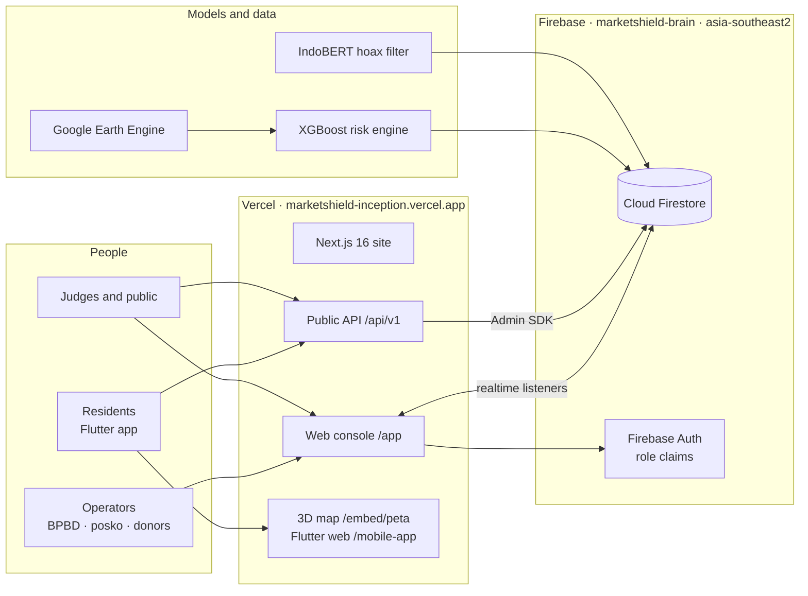

<p align="center">
  
</p>

<div align="center">

# MarketShield

**Gunung dibaca dari orbit. Warga bertindak sebelum panik.**

Satellite-based eruption early warning for residents, markets and aid posts around Indonesia's active volcanoes.

[](https://github.com/aarieffawwaz/marketshield/actions/workflows/deploy.yml)
[](https://github.com/aarieffawwaz/marketshield/actions/workflows/release-apk.yml)
[](https://github.com/aarieffawwaz/marketshield/releases/latest)
[](https://marketshield-inception.vercel.app)
<br/>


*BRAIN – Ayam Jago · BINUS University*

</div>

MarketShield is a disaster-readiness system for communities around Indonesia's active volcanoes. It reads public satellite data from Google Earth Engine, estimates the chance of thermal activity at a volcano in the next 7 days with an XGBoost model, and turns the official PVMBG alert level into one concrete next step for each resident. Residents use a free Flutter app (Android and web). BPBD officers, aid-post coordinators and donors use a Next.js web console. A public REST API exposes the same data. All three read one Cloud Firestore database in Jakarta, so a change made by an aid-post coordinator shows up on every screen within about a second.

> **Prototype.** Volcano levels follow PVMBG; MarketShield forecasts sit next to the official level and never replace it. Villages, aid posts, prices and alerts in the database are seeded demo records shaped like the real pipeline outputs. See [Known limitations](#known-limitations).

## Live links

| | |
|:-|:-|
| **Live site** | <https://marketshield-inception.vercel.app> |
| **Web console (demo)** | <https://marketshield-inception.vercel.app/app/login>: choose *Data contoh* (sample data) or *Data live*, then pick a role. No account needed |
| **Resident app in the browser** | <https://marketshield-inception.vercel.app/mobile> (the same Flutter code as the APK) |
| **Android APK** | [GitHub Releases, latest](https://github.com/aarieffawwaz/marketshield/releases/latest) · [/download](https://marketshield-inception.vercel.app/download) |
| **3D map and eruption simulation** | <https://marketshield-inception.vercel.app/embed/peta?sim=1> |
| **Public API** | <https://marketshield-inception.vercel.app/api/v1/volcanoes> · [API reference](docs/API.md) |
| **System status** | <https://marketshield-inception.vercel.app/status>: live checks from your browser every 30 seconds |
| **Demo video** | ⟨link video demo⟩ |
| **Technical documentation** | [docs/TECHNICAL_DOCUMENTATION.md](docs/TECHNICAL_DOCUMENTATION.md) |

## Preview

<div align="center">

<br/><sub>Console overview in <b>Live</b> mode. The escalation odds come from the XGBoost risk engine through Firestore; the alerts list is the live <code>alerts</code> collection.</sub>
<br/><br/>

<br/><sub>Eruption simulation on Semeru terrain: ash column, distance rings, villages and aid posts in the flow path, and an event log comparing the timeline with and without MarketShield.</sub>
<br/><br/>

<br/><sub>The resident app is the same Flutter code on Android and on the web.</sub>
</div>

<p align="center">
  
  
</p>
<p align="center"><sub>Left: <code>/status</code> checks the API and map providers from the visitor's browser. Right: <code>/api/v1/volcanoes/semeru/risk</code> returns the official level and the model forecast.</sub></p>

## Contents

[Problem](#problem) · [Solution](#solution-four-pillars) · [Features by role](#features-by-role) · [Product tour](#product-tour) · [Architecture](#architecture) · [Technology stack](#technology-stack) · [Models](#models) · [Data sources and licences](#data-sources-and-licences) · [API](#api-reference) · [Repository structure](#repository-structure) · [Getting started](#getting-started) · [Demo mode and live mode](#demo-mode-and-live-mode) · [CI/CD](#cicd) · [Testing](#testing) · [Security](#security) · [Known limitations](#known-limitations) · [Roadmap](#roadmap) · [Team](#team) · [Credits](#credits-and-third-party-licences) · [License](#license)

---

## Problem

Semeru's eruption on 4 December 2021 sent pyroclastic flows down Besuk Kobokan within an afternoon. PVMBG's alert level is precise, but it reaches residents as a status with no instruction attached, and they still have to guess what to do. Around every escalation three things go wrong at the same time:

1. **Rumours travel faster than corrections.** Chain messages on WhatsApp ("lahar has reached Pronojiwo, leave now!") spread panic before anyone can check them.
2. **Prices jump and shelves empty.** Residents buy masks and clean water all at once; pharmacies sell out in a day and get accused of price gouging.
3. **Aid goes to the easiest villages.** Villages closest to the road get supplies first, while the most exposed villages wait.

The people involved are residents of the hazard zones (KRB) around the volcano, BPBD operations officers, aid-post and village coordinators, and local pharmacies and distributors. They work in Bahasa Indonesia, often on low-end phones with weak signal.

## Solution: four pillars

<p align="center">
  
</p>

| Pillar | What it does | Answers |
|:-|:-|:-|
| **1. GeoAI predictive engine** (early action window) | Earth Engine features (NASA FIRMS, Sentinel-5P SO₂, Sentinel-1, GPM IMERG) go into an XGBoost model that gives a 7-day activity probability and its top drivers (SHAP), shown next to the official level | Time to prepare before the level rises |
| **2. Pre-emptive procurement nudge** | At Level II (Waspada) the app asks residents to build their go-kit in stages, by cohort, at price-cap (HET) prices, so demand is spread over days | Panic buying |
| **3. Anti-hoax feed** | Paste a chain message: trigger words, a satellite cross-check and the nearest official fact come back in seconds. IndoBERT is trained (98.4 % test accuracy); the API serves a rule-based classifier for now | Rumours and panic |
| **4. Emergency price tracker** | Market prices compared with the government price cap (HET); deviation above 30 % is flagged | Price speculation |

These reach people through three surfaces: the adaptive resident app, the operator console with the Aid Priority Index, and the public API (8 endpoints under `/api/v1`).

<p align="center">
  
</p>

The resident home screen follows the PVMBG level and always puts one main action at the top: prepare a go-kit at Level I, shop fairly at Level II, know your route at Level III, evacuate at Level IV.

**Where models are used, and where they are not.** Models appear only where a rule cannot do the job: combining many weak satellite signals into one probability, and reading informal Indonesian chain messages. Safety decisions stay official or deterministic.

| Responsibility | Model | Official source or deterministic code |
|:-|:-|:-|
| Volcano alert level | – | PVMBG status, stored as `volcanoes/{id}.level` |
| 7-day activity probability | XGBoost risk engine on Earth Engine features ([report](ml/README.md#2-satellite-risk-engine)) | Shown next to the official level, never replacing it |
| Message check | IndoBERT fine-tuned on 12k Indonesian texts ([report](ml/README.md#1-indobert-hoax-filter)) | Trigger words, satellite cross-check, nearest official fact; the rule-based classifier serves the API and app today |
| Aid priority | – | exposure × hazard × vulnerability ÷ (aid received + 1) |
| Price watch | – | (market − HET) ÷ HET, flagged above 30 % |
| Broadcasts | – | Signed-in BPBD operators only, staggered by cohort |

**Design choices for the people using it.** Plain Bahasa Indonesia first, with English everywhere. Works on a low-end phone and offline, from cached or bundled data. Residents need no account. Safety features are free. No field sensor has to be installed or maintained on an active volcano: every input comes from public satellite catalogues and official sources.

## Features by role

### Residents (warga): Flutter app, Android and web

- **Adaptive home** (*Beranda*): hero, main button and highlighted features change with PVMBG levels I–IV.
- **Hazard map** (*Peta*): KRB rings, ash and lahar areas, evacuation route and shelters (flutter_map); a **3D** button opens the eruption simulation in an in-app WebView.
- **Intel**: paste a chain message to get a label, trigger words, satellite cross-check and nearest official fact; verified intel feed.
- **Posko**: nearest aid posts and shelters with *Buka* / *Penuh* / *Tutup* status, capacity and needs, updated by coordinators.
- **Kit Siaga** with HET price anchors, and a price report form (on screen only in this prototype, nothing is sent yet).
- **Sector protocols**, for example farmers and livestock keepers.
- **SOS**: hold for 3 seconds.
- **Profil**: Indonesian/English, demo or live data, level simulation in demo mode, data sources and photo credits.
- **Offline**: last good data is cached per endpoint; bundled data is used when there is nothing cached. A chip shows *Live*, *Offline · data tersimpan* or *Offline · data bawaan*.
- No account needed.

### Aid-post coordinators (posko): web console

- Sign in with email or Google; role comes from a Firebase custom claim.
- Change an aid post's status (*Buka*, *Penuh*, *Tutup*), occupancy, stock and needs. Firestore rules let this role change only those fields.
- See the overview, hazard map, Aid Priority Index, and alerts and broadcasts.

### BPBD operators: web console

- **Overview**: KPIs, next actions, forecast chart from the risk engine, latest alerts.
- **Hazard map**: satellite 3D, model view and 2D.
- **Aid Priority Index** per village, and logging a delivery (which moves the next delivery to another village).
- **Posts and shelters**: status, capacity, stock.
- **Broadcasts** staggered by cohort so an announcement does not trigger panic buying.
- **Signal filter**: message check and intel feed.
- **Price watch**: HET deviation and history.
- ⌘K command palette, notifications, Indonesian/English, dark mode, guided tour (Driver.js) on the first visit.

### Donors and distributors: web console

- Overview, hazard map, Aid Priority Index and price watch, to see where supplies are needed and prove fair pricing.

### Admins

- Full write access in Firestore rules, including the official volcano level and price caps.
- Assign operator roles with `npm run set-role` (writes the custom claim and `users/{uid}`).
- Load or refresh data with `npm run seed` and publish model forecasts with `npm run publish-forecast`.
- In the console an admin gets the BPBD view.

| Console tab | BPBD | Posko | Donor |
|:-|:-:|:-:|:-:|
| Overview | ✓ | ✓ | ✓ |
| Hazard map | ✓ | ✓ | ✓ |
| Aid priority | ✓ | ✓ | ✓ |
| Posts and shelters | ✓ | ✓ | |
| Alerts and broadcasts | ✓ | ✓ | |
| Signal filter | ✓ | | |
| Price watch | ✓ | | ✓ |

## Product tour

Open **[marketshield-inception.vercel.app](https://marketshield-inception.vercel.app)**.

1. **Watch the volcano.** The landing page opens on a live 3D map. Press **Simulasi erupsi** to see the ash column, the pyroclastic flow down Besuk Kobokan and the villages in its path, with and without MarketShield.
2. **Use the resident app.** Open **[/mobile](https://marketshield-inception.vercel.app/mobile)** or install the APK. Pick *Mode demo* to move the level from I to IV and watch the home screen change, or *Data live* to read the real database. Paste a chain message into **Intel**. Tap **3D** on the map.
3. **Run the console.** Open **[/app/login](https://marketshield-inception.vercel.app/app/login)**, pick **Data contoh** or **Data live**, then enter as BPBD, an aid-post coordinator or a donor. A guided tour starts on the first visit.
4. **Change something for real.** With an operator account, switch an aid post from *Buka* to *Penuh*: every open console updates. See [Demo mode and live mode](#demo-mode-and-live-mode) for how to get operator access.
5. **Check it yourself.** Call the [API](docs/API.md), or open **[/status](https://marketshield-inception.vercel.app/status)**.

| Surface | Route | For |
|:-|:-|:-|
| Landing | `/` | Public, partners, BPBD, donors |
| Web console | `/app` | BPBD operators, aid posts, donors, distributors |
| Resident app | `/mobile`, Android APK | Residents |
| 3D map | `/embed/peta` | Opened from the app's **3D** button |
| Product pages | `/fitur` `/harga` `/docs` `/bantuan` `/kemitraan` `/blog` | Features, pricing, docs, help, partnerships, articles |
| Trust pages | `/tentang` `/pers` `/keamanan` `/status` `/changelog` | About, press kit, security and compliance, live status, release notes |
| Legal | `/privasi` `/syarat` `/kredit` | Privacy (UU PDP 27/2022), terms, photo and data credits |
| Download | `/download` | Latest APK, size and SHA-256 from GitHub Releases |
| API | `/api/v1/*` | [API reference](docs/API.md) |

## Models

| Model | Data | Held-out result |
|:-|:-|:-|
| **Satellite risk engine** (XGBoost + SHAP) | Google Earth Engine, 25 volcanoes × 407 weeks (2019–2026) | ROC-AUC **0.899** vs 0.784 persistence baseline; recall 78 % vs 63 % (test 2024–2026) |
| **IndoBERT hoax filter** | 12,136 Indonesian texts, de-duplicated before an 80/10/10 split | Accuracy **98.4 %** vs 96.9 % TF-IDF; **90 %** on 40 short WhatsApp-style messages |

<p align="center">
  
  
</p>

How we trained, the runs we discarded and why, and how to reproduce: [ml/README.md](ml/README.md).

## Demo or real

<p align="center">
  
</p>

Judges can explore the concept in **Demo** without changing anything, then switch to **Live** to see the same screens running on the real database. Live never goes blank: the app falls back to the last cached data, then to bundled data, and says so in the header (*Offline · data tersimpan 14.05*).

## Architecture

<p align="center">
  
</p>

<details>
<summary>Text version (Mermaid)</summary>



</details>

**Key decisions** (reasoning in [Technical §3](docs/TECHNICAL_DOCUMENTATION.md#3-architecture-and-decisions)):

- **Satellites instead of sensors.** Nothing to install, steal or maintain on an active volcano; every input is a public catalogue or an official source.
- **Firestore for a small team.** Realtime listeners give instant aid-post updates without a socket server, and security rules enforce roles in the database, so a UI bug cannot grant write access.
- **One Flutter codebase for Android and web.** Residents install a 20 MB APK; judges and partners open the same app in a browser.
- **Fallback everywhere.** The API, the console and the app all ship bundled data and say when they use it. A disaster app that goes blank when the network drops is worse than none.

## Technology stack

| Layer | Technology | Why |
|:-|:-|:-|
| Resident app | Flutter 3.41, Dart 3.11, flutter_map, http, shared_preferences, webview_flutter | One codebase for Android and web; offline cache; small APK |
| Website and console | Next.js 16 (App Router, Turbopack), React 19, TypeScript, Tailwind CSS 4, Motion, Zustand, Recharts, Driver.js | Static marketing pages, client console, Indonesian/English, dark mode |
| Maps and 3D | MapLibre GL 6.16, three.js 0.186 | Globe projection, terrain, custom WebGL layer for the eruption |
| Backend | Next.js route handlers on Vercel, Firebase Admin SDK | Public API next to the site, no separate server to run |
| Database and auth | Cloud Firestore (Jakarta), Firebase Auth (email, Google), security rules | Realtime, role claims, data close to users |
| Data and models | Google Earth Engine (10 datasets), XGBoost, IndoBERT (`indobenchmark/indobert-base-p1`), Google Colab | Public satellite data; tabular risk model; Indonesian language model |
| Delivery | GitHub Actions, Vercel CLI, GitHub Releases | Build check per PR, production on merge, signed APKs per tag |

## Getting started

**Requirements:** Node.js 20+, Flutter 3.41 (stable). A Firebase service account is needed only for live data.

```bash
git clone https://github.com/aarieffawwaz/marketshield.git
cd marketshield/web
npm install          # also copies the MapLibre worker into public/vendor
npm run dev          # http://localhost:3000, serves bundled demo data
```

Live data locally (optional):

```bash
cp .env.example .env.local
# FIREBASE_SERVICE_ACCOUNT=<service-account JSON or base64>
npm run seed         # load the demo dataset into Firestore (idempotent)
npm run set-role -- operator@example.org bpbd "Nama Operator" "BPBD Kab. Lumajang"
```

Resident app:

```bash
cd ../app
flutter pub get
flutter run                     # Android device or emulator
flutter run -d chrome           # web; add ?mode=demo or ?mode=live
```

To serve the app at `/mobile` locally: `flutter build web --release --base-href /mobile-app/ --no-web-resources-cdn && cp -R build/web/. ../web/public/mobile-app/`.

## Delivery

<p align="center">
  
</p>

- **Website and console:** every PR runs the full Flutter web and Next.js build as a check; merging to `main` deploys to production. Preview uploads were turned off after they used up Vercel's free daily upload quota.
- **Android:** bump `version` in `app/pubspec.yaml`, then `git tag v1.0.1 && git push --tags`. CI builds signed APKs and publishes the release; [/download](https://marketshield-inception.vercel.app/download) reads the latest one.

Repository secrets: `VERCEL_TOKEN`, `VERCEL_ORG_ID`, `VERCEL_PROJECT_ID`, `ANDROID_KEYSTORE_BASE64`, `ANDROID_KEYSTORE_PASSWORD`, `ANDROID_KEY_ALIAS`, `ANDROID_KEY_PASSWORD`. Vercel holds `FIREBASE_SERVICE_ACCOUNT`.

## Security overview

- **Roles are enforced by the database.** Firestore rules allow public reads only for reference data; aid-post coordinators can change only status fields; `signals`, `reports` and `users` are private. Checked from an anonymous client: `volcanoes` 200, `signals` 403.
- **Least-privilege keys.** The API's service account has Datastore User and Firebase Auth Admin only; notebooks use a separate Datastore-only account. The browser key is restricted to our domains.
- **Data minimisation (UU PDP 27/2022).** The hoax check stores label, confidence and trigger words, never the message text. The resident app works without an account.
- **Secrets stay out of git.** Keys live in GitHub and Vercel secrets; `.env*`, keystores and AI helper files are git-ignored.

The full self-assessment, including a notebook key that was exposed and disabled during development, is in [SECURITY_SELF_ASSESSMENT.md](docs/SECURITY_SELF_ASSESSMENT.md).

## Testing and evidence

| Check | Result |
|:-|:-|
| Production deploys | Merges to `main` deploy through GitHub Actions: 6 succeeded on 31 Oct, 4 were cancelled by a newer merge, 1 hit Vercel's daily upload quota |
| Live API | All 7 read endpoints answer from Firestore in production; the risk endpoint includes the model forecast |
| Firestore rules, anonymous client | Public collections 200; `signals` and `users` 403 |
| Operator write, end to end | Posko coordinator signs in, sets *Posko Pronojiwo* to open, Firestore updates, then reverted |
| Demo and live view-only | Demo change stays on screen only; live view-only change is refused; Firestore untouched |
| Page audit | 23 routes at 1440 px and 390 px: no console errors, no horizontal overflow, no broken images |
| Flutter | `flutter analyze` clean, 7 tests pass, web release build succeeds |
| APK integrity | v1.0.0 SHA-256 published in the release (`SHA256SUMS.txt`) and on `/download` |

Commands, timestamps, sample responses and a **screenshot gallery** (Firebase, Earth Engine, Colab, Vercel, GitHub): [EXECUTION_EVIDENCE.md](docs/EXECUTION_EVIDENCE.md#8-screenshot-gallery).

<p align="center">
  
  
  
  
</p>

## AI Use and Third-Party Declaration

Required by the competition rules. Full list with licences: [AI_USE_AND_THIRD_PARTY.md](docs/AI_USE_AND_THIRD_PARTY.md).

**AI inside the product**

| Component | Model | Status |
|:-|:-|:-|
| Risk engine | XGBoost + SHAP, trained by the team on Google Earth Engine features for 25 volcanoes (2019–2026); target = NASA FIRMS thermal activity in the next 7 days (a satellite proxy, not the PVMBG level) | ROC-AUC 0.90 vs 0.78 baseline on 2024–2026; forecast in `volcanoes/{id}.forecast` |
| Hoax filter | IndoBERT (`indobenchmark/indobert-base-p1`) fine-tuned by the team on the public `mzuama/IndonesianHoaxdetection` dataset plus 60 team-written short disaster messages | 98.4 % test accuracy, 90 % on a 40-message probe set; served by the API next (rule-based classifier meanwhile) |

**AI used to build the product**

| Tool | Used for |
|:-|:-|
| Claude Code (Anthropic) | Writing and refactoring code for the website, console, API, Flutter app and CI; debugging; writing this documentation and drawing its diagrams. The team reviewed, tested and merged every change through pull requests. |

**Third-party data, services and assets**

- **Satellite and geospatial data:** Google Earth Engine catalogue: Sentinel-1, Sentinel-2, Sentinel-5P, NASA FIRMS, MODIS, Landsat 9, GPM IMERG, NOAA GFS, Copernicus DEM, WorldPop, ESA WorldCover.
- **Official information:** PVMBG / MAGMA Indonesia volcano levels; government price caps (HET).
- **Map tiles:** Sentinel-2 cloudless by EOX (CC BY-NC-SA 4.0, non-commercial), AWS Terrain Tiles, Esri basemaps, © OpenStreetMap contributors (ODbL), Natural Earth.
- **Photos:** Wikimedia Commons, each with author and licence in [`photo-credits.json`](web/src/lib/photo-credits.json) and on [/kredit](https://marketshield-inception.vercel.app/kredit).
- **3D models:** NVIDIA SimReady Assets (CC BY 4.0).
- **Logos:** agency and brand marks identify data sources and target users only; no partnership is implied. Brand icons from Simple Icons (CC0).
- **Open-source libraries:** MIT, Apache-2.0, BSD or ISC licensed; full table in the declaration.

## Documentation

| Document | Contents |
|:-|:-|
| [Technical documentation](docs/TECHNICAL_DOCUMENTATION.md) | Architecture and decisions, app, console, backend, data model, models, deployment, operations |
| [API reference](docs/API.md) | Every endpoint with parameters and sample responses |
| [Security self-assessment](docs/SECURITY_SELF_ASSESSMENT.md) | Threat model, controls, findings and their status |
| [Execution evidence](docs/EXECUTION_EVIDENCE.md) | What was run, when, and what it returned |
| [AI use and third parties](docs/AI_USE_AND_THIRD_PARTY.md) | Full declaration with licences |
| [Firestore schema](firebase/SCHEMA.md) · [ML data contract](firebase/ML-CONTRACT.md) | Collections, fields and roles; how notebooks write |
| [Changelog](CHANGELOG.md) | Release history |

## Known limitations

- **Seeded operational data.** Villages, aid posts, prices, alerts and intel are realistic demo records in Firestore, not yet fed by BPBD or market surveys.
- **Models are trained offline.** The risk engine and IndoBERT are trained and evaluated in `ml/` and the forecast is published to Firestore with a script; the 6-hourly schedule and serving IndoBERT behind the API are next. The risk target is a satellite proxy for eruptive activity, not the PVMBG alert level.
- **One volcano in depth.** Semeru has full detail (villages, posts, risk); the other 24 mapped volcanoes have hazard rings only.
- **No push notifications yet.** Broadcasts appear in the console and in the app feed; FCM delivery is next.
- **Android only for the native app.** iOS and the Play Store are planned. v1.0.0 is signed with a debug key; later releases use the release key.
- **Map imagery licence.** EOX Sentinel-2 cloudless is non-commercial; a commercial launch needs another imagery source.

## Next steps

1. Schedule the Earth Engine feature pipeline and the risk model every 6 hours (GitHub Actions + service account).
2. Serve the fine-tuned IndoBERT model behind `/api/v1/signals/check`.
3. FCM push notifications with cohort staggering.
4. Pilot with one village on Semeru's slopes and BPBD Lumajang, with real aid-post and price data.
5. Play Store release (PSE registration) and an iOS build.

## Team

**BRAIN – Ayam Jago**, BINUS University: product and design, data and geospatial, machine learning, mobile and web.

## License

Source code: all rights reserved by the team until a licence is chosen. Third-party data, photos and models keep their own licences (see the declaration above).
