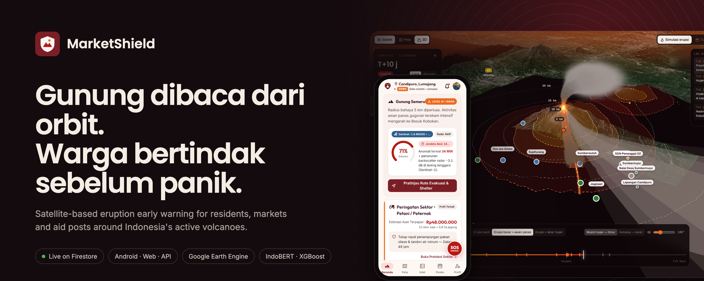
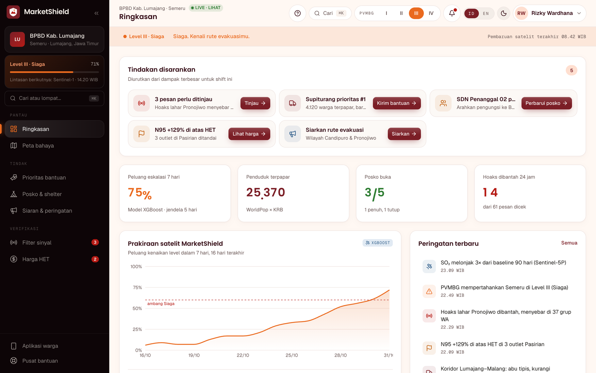
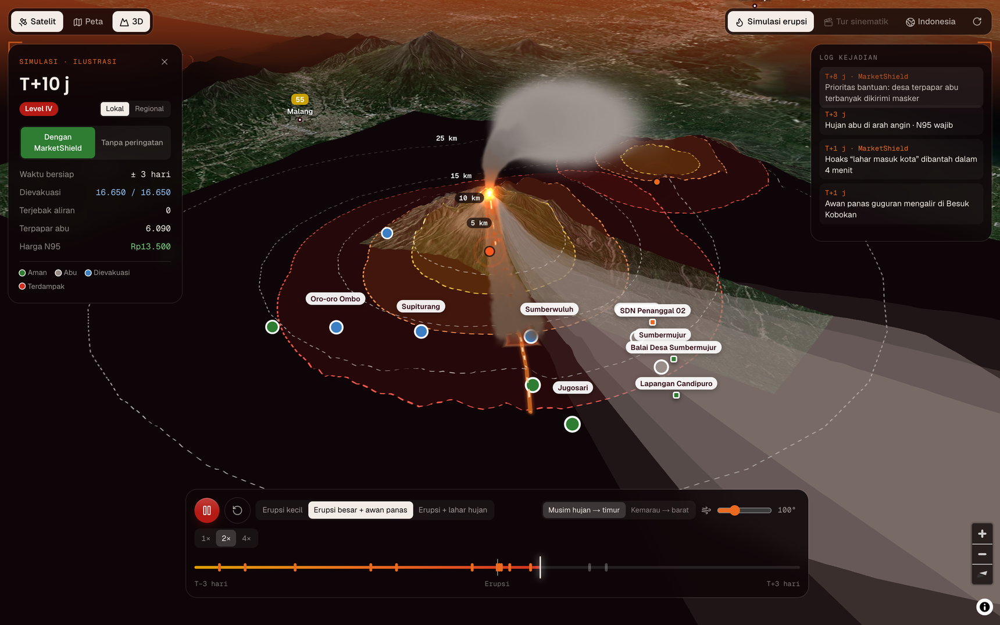
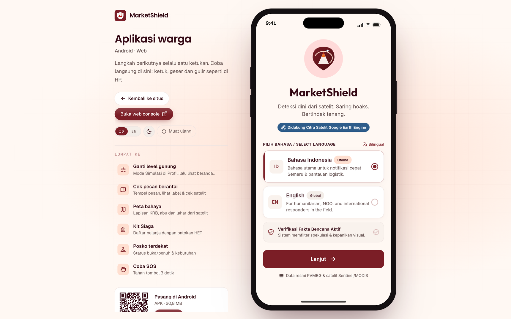
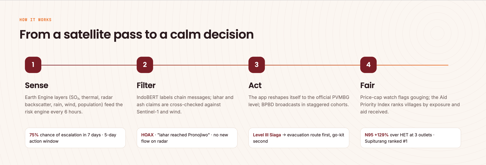
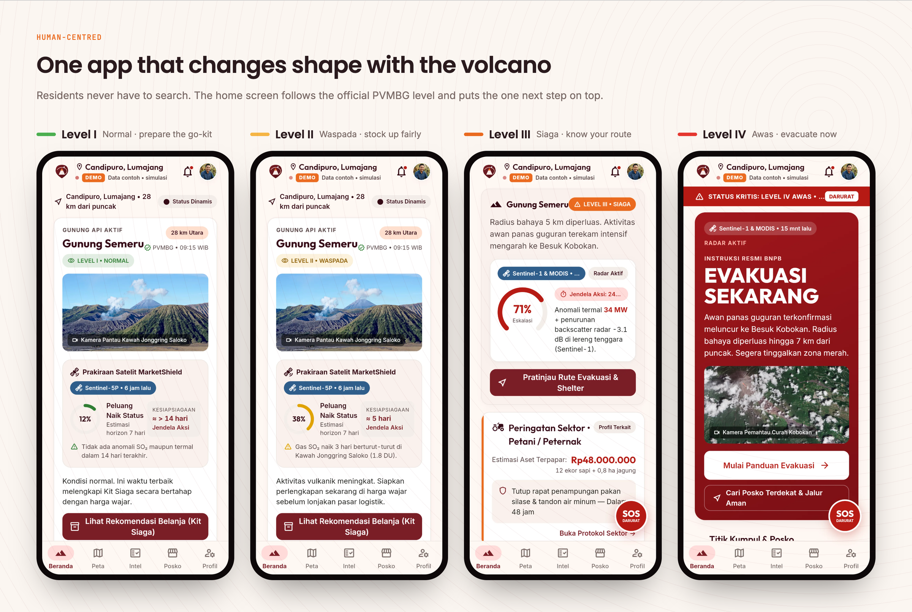
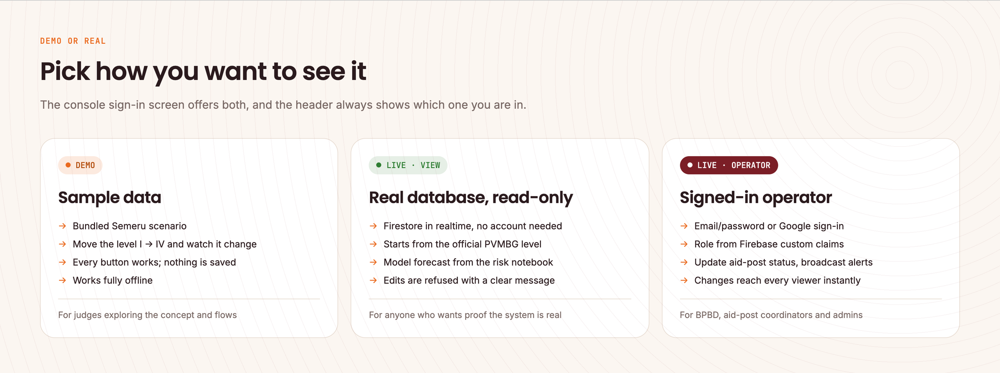
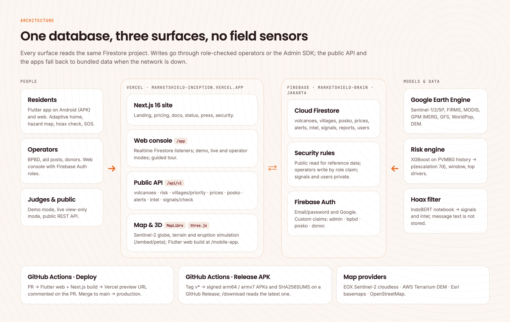
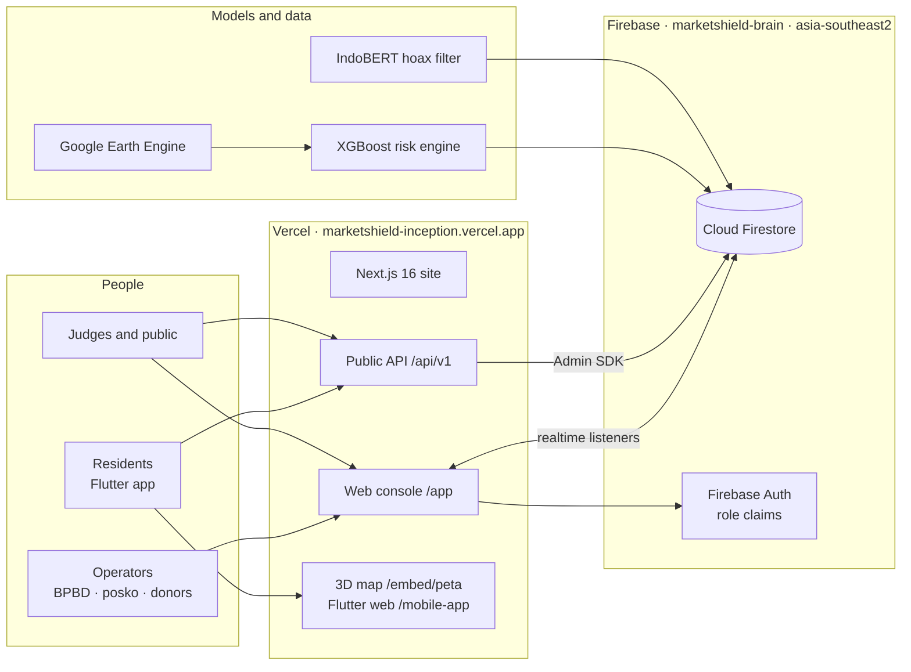
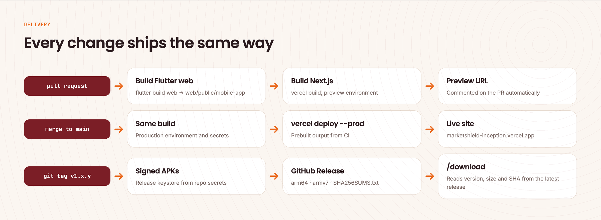

<p align="center">
  
</p>

<div align="center">

# MarketShield

**Gunung dibaca dari orbit. Warga bertindak sebelum panik.**

Satellite-based eruption early warning for residents, markets and aid posts around Indonesia's active volcanoes: satellites sense, a model forecasts, and the app tells every resident the one next step.

[**Live site**](https://marketshield-inception.vercel.app) · [**Web console**](https://marketshield-inception.vercel.app/app/login) · [**Resident app**](https://marketshield-inception.vercel.app/mobile) · [**Download APK**](https://github.com/aarieffawwaz/marketshield/releases/latest) · [**Technical documentation**](docs/TECHNICAL_DOCUMENTATION.md)


*BRAIN – Ayam Jago · BINUS University*

</div>

> **Prototype.** Volcano levels follow PVMBG; MarketShield forecasts complement, never replace, official information. Villages, aid posts, prices and alerts in the database are seeded demo records shaped like the real pipeline outputs. See [Known limitations](#known-limitations).

| | |
|:-|:-|
| **Live site** | <https://marketshield-inception.vercel.app> |
| **Web console** | <https://marketshield-inception.vercel.app/app/login>: choose *Data contoh* or *Data live*, no account needed |
| **Resident app** | Android APK on [GitHub Releases](https://github.com/aarieffawwaz/marketshield/releases/latest) · same app in the browser at [/mobile](https://marketshield-inception.vercel.app/mobile) |
| **Public API** | <https://marketshield-inception.vercel.app/api/v1/volcanoes> · [API reference](docs/API.md) |
| **System status** | <https://marketshield-inception.vercel.app/status>: live checks from your browser |

## Contents

[Overview](#overview) · [Key capabilities](#key-capabilities) · [Product tour](#product-tour) · [How it works](#how-it-works) · [Demo or real](#demo-or-real) · [Architecture](#architecture) · [Technology stack](#technology-stack) · [Getting started](#getting-started) · [Delivery](#delivery) · [Security overview](#security-overview) · [Testing and evidence](#testing-and-evidence) · [AI Use and Third-Party Declaration](#ai-use-and-third-party-declaration) · [Documentation](#documentation) · [Known limitations](#known-limitations) · [Next steps](#next-steps) · [Team](#team)

---

## Overview

**The problem.** Semeru's eruption on 4 December 2021 sent pyroclastic flows down Besuk Kobokan within an afternoon. PVMBG's alert level is precise, but it reaches residents as a status, not as an instruction. Around every escalation three things go wrong at once: chain messages on WhatsApp spread panic faster than corrections ("lahar has reached Pronojiwo, leave now!"), mask and clean-water prices jump while shelves empty, and aid goes to the villages that are easiest to reach rather than those that need it most.

**What MarketShield is.** A disaster-readiness system that turns public satellite data into one clear next step for each person:

- **Residents** get a free Android app whose home screen changes shape with the PVMBG level: prepare a go-kit at Level I, stock up fairly at Level II, know your route at Level III, evacuate at Level IV. Chain messages can be checked in seconds, and the nearest aid post shows whether it is open or full.
- **Local government (BPBD) and aid posts** get a web console with a satellite forecast, an Aid Priority Index per village, price-cap (HET) monitoring and broadcasts staggered by cohort so they do not trigger panic buying.
- **Everyone reads the same live database.** An aid post marked *Penuh* by its coordinator turns orange on every console within a second.

**Who it serves.** Residents of the hazard zones (KRB) around Semeru and 24 other mapped volcanoes; BPBD operations officers; aid-post and village coordinators; pharmacies and distributors who want proof of fair pricing.

**Why it fits "Building Resilient Communities Through Human-Centered Digital Innovation".** The design starts from the resident's questions (*am I in danger, what should I buy, where do I go, is this message true?*) and answers them in plain Bahasa Indonesia, on a low-end phone, with weak signal, offline if needed. Safety features are never behind a paywall. No field sensor has to be installed or maintained on an active volcano: every input comes from public satellite catalogues and official sources.

## Key capabilities

| Area | What is implemented | Details |
|:-|:-|:-|
| Adaptive resident app | Flutter app (Android + web); home, primary action and highlighted features follow PVMBG levels I–IV; demo/live data modes; offline cache | [Technical §4](docs/TECHNICAL_DOCUMENTATION.md#4-resident-app-flutter) |
| Satellite forecast | 7-day escalation probability, action window and top drivers written by the risk-engine notebook; shown in the console and served by the API | [Technical §7](docs/TECHNICAL_DOCUMENTATION.md#7-data-and-models) |
| Hoax filter | Message check with trigger words, satellite cross-check and nearest official fact; stores outcomes only, never message text | [Technical §7.3](docs/TECHNICAL_DOCUMENTATION.md#73-hoax-filter) |
| Live database | Cloud Firestore in Jakarta with security rules; realtime listeners in the console | [Technical §6](docs/TECHNICAL_DOCUMENTATION.md#6-backend-database-and-auth) |
| Operator console | Overview, hazard map, Aid Priority Index, posts and shelters, broadcasts, signal filter, price watch, guided tour; Firebase Auth (email or Google) with role claims | [Technical §5](docs/TECHNICAL_DOCUMENTATION.md#5-web-console) |
| Demo and live modes | Sample-data demo for exploring, live view-only for proof, operator mode for writes; a badge always shows which | [Demo or real](#demo-or-real) |
| 3D map and eruption simulation | MapLibre globe on Sentinel-2 imagery with terrain; three.js ash column, ejecta and pyroclastic flow; regional ash plume with per-city AQI and price impact; opened from the app's **3D** button | [Technical §5.3](docs/TECHNICAL_DOCUMENTATION.md#53-map-3d-and-eruption-simulation) |
| Public API | 8 REST endpoints under `/api/v1`, CORS-enabled; each response says whether it came from Firestore or the fallback | [API reference](docs/API.md) |
| Delivery | GitHub Actions: build check per PR, production deploy on merge, signed APK release per tag | [Delivery](#delivery) |

## Product tour

Open **[marketshield-inception.vercel.app](https://marketshield-inception.vercel.app)**.

1. **Watch the volcano.** The landing page opens on a live 3D map. Press **Simulasi erupsi** to see the ash column, the pyroclastic flow down Besuk Kobokan and the villages in its path, with and without MarketShield.
2. **Use the resident app.** Open **[/mobile](https://marketshield-inception.vercel.app/mobile)** or install the APK. Pick *Mode demo* to move the level from I to IV and watch the home screen change, or *Data live* to read the real database. Paste a chain message into **Intel**. Tap **3D** on the map.
3. **Run the console.** Open **[/app/login](https://marketshield-inception.vercel.app/app/login)**, pick **Data contoh** or **Data live**, then jump in as BPBD, an aid-post coordinator or a donor. A guided tour starts on the first visit.
4. **Change something for real.** Sign in as an operator (email or Google) and switch an aid post from *Buka* to *Penuh*: every open console updates.
5. **Check it yourself.** Call the [API](docs/API.md), or open **[/status](https://marketshield-inception.vercel.app/status)**, which pings the API and map servers from your browser every 30 seconds.

| Surface | Route | For |
|:-|:-|:-|
| Landing | `/` | Judges, partners, BPBD, donors |
| Web console | `/app` | BPBD operators, aid posts, donors, distributors |
| Resident app | `/mobile`, Android APK | Residents |
| 3D map | `/embed/peta` | Opened from the app's **3D** button |
| Product pages | `/fitur` `/harga` `/docs` `/bantuan` `/kemitraan` `/blog` | Features, pricing, docs, help, partnerships, articles |
| Trust pages | `/tentang` `/pers` `/keamanan` `/status` `/changelog` | About, press kit, security and compliance, live status, release notes |
| Legal | `/privasi` `/syarat` `/kredit` | Privacy (UU PDP 27/2022), terms, photo and data credits |
| API | `/api/v1/*` | [API reference](docs/API.md) |

<div align="center">

<br/><sub>Console overview in <b>Live</b> mode. The 75% escalation odds and the 5-day window come from the risk-engine notebook through Firestore; the alerts list is the live <code>alerts</code> collection.</sub>
<br/><br/>

<br/><sub>Eruption simulation on Semeru terrain: ash column, distance rings, villages and aid posts in the flow path, and an event log comparing the timeline with and without MarketShield.</sub>
<br/><br/>

<br/><sub>The resident app is the same Flutter code on Android and on the web.</sub>
</div>

## How it works

<p align="center">
  
</p>

<p align="center">
  
</p>

**Where AI is used, and where it is not.** Models appear only where a rule cannot do the job: combining many weak satellite signals into one escalation probability, and reading informal Indonesian chain messages. Everything that decides safety stays official or deterministic.

| Responsibility | Model | Official source or deterministic code |
|:-|:-|:-|
| Volcano alert level | – | PVMBG status, stored as `volcanoes/{id}.level` |
| 7-day escalation probability | XGBoost risk engine (team notebook) | Shown next to the official level, never replacing it |
| Message check | IndoBERT classifier (team notebook, fine-tuning in progress) | Trigger words, satellite cross-check, nearest official fact; rule-based classifier in the API and app |
| Aid priority | – | exposure × hazard × vulnerability ÷ (aid received + 1) |
| Price watch | – | (market − HET) ÷ HET, flagged above 30% |
| Broadcasts | – | Signed-in BPBD operators only, staggered by cohort |

## Demo or real

<p align="center">
  
</p>

Judges can explore the concept in **Demo** without changing anything, then switch to **Live** to see the same screens running on the real database. Live never goes blank: the app falls back to the last cached data, then to bundled data, and says so in the header (*Offline · data tersimpan 14.05*).

## Architecture

<p align="center">
  
</p>

<details>
<summary>Text version (Mermaid)</summary>



</details>

**Key decisions** (reasoning in [Technical §3](docs/TECHNICAL_DOCUMENTATION.md#3-architecture-and-decisions)):

- **Satellites instead of sensors.** Nothing to install, steal or maintain on an active volcano; every input is a public catalogue or an official source.
- **Firestore for a small team.** Realtime listeners give instant aid-post updates without a socket server, and security rules enforce roles in the database, so a UI bug cannot grant write access.
- **One Flutter codebase for Android and web.** Residents install a 20 MB APK; judges and partners open the same app in a browser.
- **Fallback everywhere.** The API, the console and the app all ship bundled data and say when they use it. A disaster app that goes blank when the network drops is worse than none.

## Technology stack

| Layer | Technology | Why |
|:-|:-|:-|
| Resident app | Flutter 3.41, Dart 3.11, flutter_map, http, shared_preferences, webview_flutter | One codebase for Android and web; offline cache; small APK |
| Website and console | Next.js 16 (App Router, Turbopack), React 19, TypeScript, Tailwind CSS 4, Motion, Zustand, Recharts, Driver.js | Static marketing pages, client console, Indonesian/English, dark mode |
| Maps and 3D | MapLibre GL 6.16, three.js 0.186 | Globe projection, terrain, custom WebGL layer for the eruption |
| Backend | Next.js route handlers on Vercel, Firebase Admin SDK | Public API next to the site, no separate server to run |
| Database and auth | Cloud Firestore (Jakarta), Firebase Auth (email, Google), security rules | Realtime, role claims, data close to users |
| Data and models | Google Earth Engine (10 datasets), XGBoost, IndoBERT (`indobenchmark/indobert-base-p1`), Google Colab | Public satellite data; tabular risk model; Indonesian language model |
| Delivery | GitHub Actions, Vercel CLI, GitHub Releases | Build check per PR, production on merge, signed APKs per tag |

## Getting started

**Requirements:** Node.js 20+, Flutter 3.41 (stable). A Firebase service account is needed only for live data.

```bash
git clone https://github.com/aarieffawwaz/marketshield.git
cd marketshield/web
npm install          # also copies the MapLibre worker into public/vendor
npm run dev          # http://localhost:3000, serves bundled demo data
```

Live data locally (optional):

```bash
cp .env.example .env.local
# FIREBASE_SERVICE_ACCOUNT=<service-account JSON or base64>
npm run seed         # load the demo dataset into Firestore (idempotent)
npm run set-role -- operator@example.org bpbd "Nama Operator" "BPBD Kab. Lumajang"
```

Resident app:

```bash
cd ../app
flutter pub get
flutter run                     # Android device or emulator
flutter run -d chrome           # web; add ?mode=demo or ?mode=live
```

To serve the app at `/mobile` locally: `flutter build web --release --base-href /mobile-app/ --no-web-resources-cdn && cp -R build/web/. ../web/public/mobile-app/`.

## Delivery

<p align="center">
  
</p>

- **Website and console:** every PR runs the full Flutter web and Next.js build as a check; merging to `main` deploys to production. Preview uploads were turned off after they used up Vercel's free daily upload quota.
- **Android:** bump `version` in `app/pubspec.yaml`, then `git tag v1.0.1 && git push --tags`. CI builds signed APKs and publishes the release; [/download](https://marketshield-inception.vercel.app/download) reads the latest one.

Repository secrets: `VERCEL_TOKEN`, `VERCEL_ORG_ID`, `VERCEL_PROJECT_ID`, `ANDROID_KEYSTORE_BASE64`, `ANDROID_KEYSTORE_PASSWORD`, `ANDROID_KEY_ALIAS`, `ANDROID_KEY_PASSWORD`. Vercel holds `FIREBASE_SERVICE_ACCOUNT`.

## Security overview

- **Roles are enforced by the database.** Firestore rules allow public reads only for reference data; aid-post coordinators can change only status fields; `signals`, `reports` and `users` are private. Checked from an anonymous client: `volcanoes` 200, `signals` 403.
- **Least-privilege keys.** The API's service account has Datastore User and Firebase Auth Admin only; notebooks use a separate Datastore-only account. The browser key is restricted to our domains.
- **Data minimisation (UU PDP 27/2022).** The hoax check stores label, confidence and trigger words, never the message text. The resident app works without an account.
- **Secrets stay out of git.** Keys live in GitHub and Vercel secrets; `.env*`, keystores and AI helper files are git-ignored.

The full self-assessment, including a notebook key that was exposed and disabled during development, is in [SECURITY_SELF_ASSESSMENT.md](docs/SECURITY_SELF_ASSESSMENT.md).

## Testing and evidence

| Check | Result |
|:-|:-|
| Production deploys | Merges to `main` deploy through GitHub Actions: 6 succeeded on 31 Oct, 4 were cancelled by a newer merge, 1 hit Vercel's daily upload quota |
| Live API | All 7 read endpoints answer from Firestore in production; the risk endpoint includes the model forecast |
| Firestore rules, anonymous client | Public collections 200; `signals` and `users` 403 |
| Operator write, end to end | Posko coordinator signs in, sets *Posko Pronojiwo* to open, Firestore updates, then reverted |
| Demo and live view-only | Demo change stays on screen only; live view-only change is refused; Firestore untouched |
| Page audit | 23 routes at 1440 px and 390 px: no console errors, no horizontal overflow, no broken images |
| Flutter | `flutter analyze` clean, 7 tests pass, web release build succeeds |
| APK integrity | v1.0.0 SHA-256 published in the release (`SHA256SUMS.txt`) and on `/download` |

Commands, timestamps and sample responses: [EXECUTION_EVIDENCE.md](docs/EXECUTION_EVIDENCE.md).

## AI Use and Third-Party Declaration

Required by the competition rules. Full list with licences: [AI_USE_AND_THIRD_PARTY.md](docs/AI_USE_AND_THIRD_PARTY.md).

**AI inside the product**

| Component | Model | Status |
|:-|:-|:-|
| Risk engine | XGBoost on PVMBG status history and Earth Engine features, built by the team in a Colab notebook | Writes `volcanoes/semeru.forecast`; shown in the console and the risk API |
| Hoax filter | IndoBERT (`indobenchmark/indobert-base-p1`), fine-tuned by the team on a self-curated corpus of Indonesian disaster messages | Fine-tuning in progress; the API and the app use a rule-based classifier meanwhile |

**AI used to build the product**

| Tool | Used for |
|:-|:-|
| Claude Code (Anthropic) | Writing and refactoring code for the website, console, API, Flutter app and CI; debugging; writing this documentation and drawing its diagrams. The team reviewed, tested and merged every change through pull requests. |

**Third-party data, services and assets**

- **Satellite and geospatial data:** Google Earth Engine catalogue: Sentinel-1, Sentinel-2, Sentinel-5P, NASA FIRMS, MODIS, Landsat 9, GPM IMERG, NOAA GFS, Copernicus DEM, WorldPop, ESA WorldCover.
- **Official information:** PVMBG / MAGMA Indonesia volcano levels; government price caps (HET).
- **Map tiles:** Sentinel-2 cloudless by EOX (CC BY-NC-SA 4.0, non-commercial), AWS Terrain Tiles, Esri basemaps, © OpenStreetMap contributors (ODbL), Natural Earth.
- **Photos:** Wikimedia Commons, each with author and licence in [`photo-credits.json`](web/src/lib/photo-credits.json) and on [/kredit](https://marketshield-inception.vercel.app/kredit).
- **3D models:** NVIDIA SimReady Assets (CC BY 4.0).
- **Logos:** agency and brand marks identify data sources and target users only; no partnership is implied. Brand icons from Simple Icons (CC0).
- **Open-source libraries:** MIT, Apache-2.0, BSD or ISC licensed; full table in the declaration.

## Documentation

| Document | Contents |
|:-|:-|
| [Technical documentation](docs/TECHNICAL_DOCUMENTATION.md) | Architecture and decisions, app, console, backend, data model, models, deployment, operations |
| [API reference](docs/API.md) | Every endpoint with parameters and sample responses |
| [Security self-assessment](docs/SECURITY_SELF_ASSESSMENT.md) | Threat model, controls, findings and their status |
| [Execution evidence](docs/EXECUTION_EVIDENCE.md) | What was run, when, and what it returned |
| [AI use and third parties](docs/AI_USE_AND_THIRD_PARTY.md) | Full declaration with licences |
| [Firestore schema](firebase/SCHEMA.md) · [ML data contract](firebase/ML-CONTRACT.md) | Collections, fields and roles; how notebooks write |
| [Changelog](CHANGELOG.md) | Release history |

## Known limitations

- **Seeded operational data.** Villages, aid posts, prices, alerts and intel are realistic demo records in Firestore, not yet fed by BPBD or market surveys.
- **Models run in notebooks.** The XGBoost forecast and IndoBERT labels are written to Firestore from Colab; the 6-hourly Earth Engine pipeline is not scheduled yet, and the API's message check uses the rule-based classifier.
- **One volcano in depth.** Semeru has full detail (villages, posts, risk); the other 24 mapped volcanoes have hazard rings only.
- **No push notifications yet.** Broadcasts appear in the console and in the app feed; FCM delivery is next.
- **Android only for the native app.** iOS and the Play Store are planned. v1.0.0 is signed with a debug key; later releases use the release key.
- **Map imagery licence.** EOX Sentinel-2 cloudless is non-commercial; a commercial launch needs another imagery source.

## Next steps

1. Schedule the Earth Engine feature pipeline and the risk model every 6 hours (GitHub Actions + service account).
2. Serve the fine-tuned IndoBERT model behind `/api/v1/signals/check`.
3. FCM push notifications with cohort staggering.
4. Pilot with one village on Semeru's slopes and BPBD Lumajang, with real aid-post and price data.
5. Play Store release (PSE registration) and an iOS build.

## Team

**BRAIN – Ayam Jago**, BINUS University: product and design, data and geospatial, machine learning, mobile and web.

## License

Source code: all rights reserved by the team until a licence is chosen. Third-party data, photos and models keep their own licences (see the declaration above).
