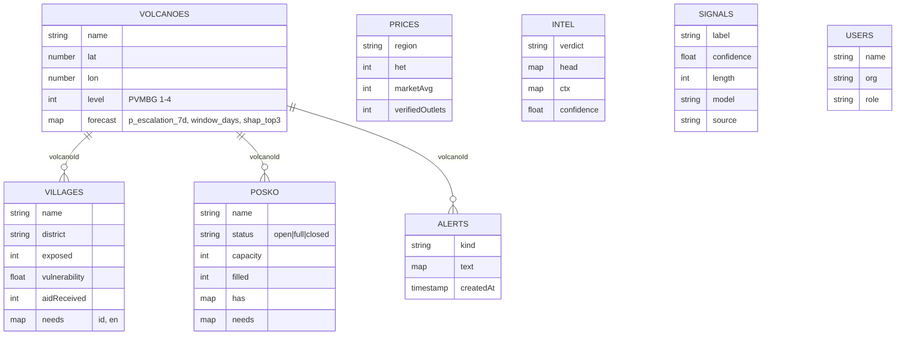

<p align="center"></p>

# MarketShield technical documentation

Version: `main` after PR #21 · 31 October 2026 (WIB) · Live: <https://marketshield-inception.vercel.app>

## Contents

1. [Purpose and scope](#1-purpose-and-scope)
2. [Repository layout](#2-repository-layout)
3. [Architecture and decisions](#3-architecture-and-decisions)
4. [Resident app (Flutter)](#4-resident-app-flutter)
5. [Web console](#5-web-console)
6. [Backend, database and auth](#6-backend-database-and-auth)
7. [Data and models](#7-data-and-models)
8. [Deployment and releases](#8-deployment-and-releases)
9. [Configuration and secrets](#9-configuration-and-secrets)
10. [Quality and testing](#10-quality-and-testing)
11. [Operations](#11-operations)
12. [Accessibility, language and offline use](#12-accessibility-language-and-offline-use)
13. [Limitations and roadmap](#13-limitations-and-roadmap)

## 1. Purpose and scope

MarketShield gives residents, aid posts and local government around Indonesia's active volcanoes a shared, satellite-informed picture of what to do next. This document describes the system as built: the Flutter resident app, the Next.js website and console, the public API, the Firebase backend, the data and model pipeline, and how changes are delivered.

Out of scope: the official alert level itself, which always comes from PVMBG; MarketShield never issues evacuation orders.

## 2. Repository layout

```
app/                     Flutter resident app (Android + web)
  lib/core.dart          bundled models and demo data
  lib/data/              api.dart (HTTP client), repository.dart (cache → fallback), mappers.dart, credits.dart
  lib/screens/           home shell, map, intel, posko, sector, sos, profile, credits, onboarding
  lib/geo_map.dart       flutter_map hazard map (KRB rings, ash, lahar, routes, posts)
  android/               Gradle; release signing from android/key.properties (CI only)
web/                     Next.js 16 site, console and API
  src/app/               routes: /, /app, /mobile, /embed/peta, /download, marketing, legal, trust pages
  src/app/api/v1/        route handlers (public API)
  src/components/        landing, map (MapLibre + three.js), webapp (console), pages, site, ui
  src/lib/               data.ts (bundled data), geo.ts, classify.ts, store.ts (zustand),
                         live.ts (Firestore listeners), auth.ts, release.ts, server/ (Admin SDK, repository)
  scripts/               seed.ts, set-role.ts
firebase/                firestore.rules, indexes, SCHEMA.md, ML-CONTRACT.md
.github/workflows/       deploy.yml, release-apk.yml
docs/                    this documentation and README figures
```

## 3. Architecture and decisions

Three surfaces (resident app, console, public API) share one Firestore project. The website, console and API run on Vercel; the Flutter web build is served from the same domain under `/mobile-app`. Models run in notebooks and write results to Firestore under a documented contract.

| Decision | Alternatives considered | Why this one |
|:-|:-|:-|
| Public satellite data (Earth Engine) instead of field sensors | Seismometers, gas sensors, CCTV | No hardware on an active volcano; national coverage from day one; reproducible from public catalogues |
| Cloud Firestore | PostgreSQL + WebSocket server, Supabase | Realtime listeners without running a server; security rules enforce roles in the database; free tier; Jakarta region |
| Next.js route handlers for the API | Separate Express/FastAPI service | One deployment, same domain (no CORS for the console), Admin SDK on the server only |
| Flutter for the resident app | React Native, PWA only | One codebase for a small Android APK and a web build judges can open |
| MapLibre + three.js | Mapbox GL, Cesium | Open source, globe projection and terrain, custom WebGL layer for the eruption without a licence key |
| Bundled data + fallback on every surface | Fail closed | A disaster app must not go blank; each surface states when it is not live |
| Demo / live / operator modes | Separate demo site | Judges see concept and reality in the same UI; writes only for authenticated operators |
| Message text never stored | Store for retraining | UU PDP data minimisation; training data is curated separately |

## 4. Resident app (Flutter)

**Screens.** Onboarding (language, persona, data source) → shell with five tabs: *Beranda* (home), *Peta* (map), *Intel* (fact check and feed), *Posko* (shelters and aid posts), *Profil*. Extra screens: SOS (hold 3 seconds), evacuation route, Kit Siaga with price-cap anchors, sector protocols, fact-check result, data sources and photo credits, 3D map.

**Adaptive home.** The home screen derives its hero, primary button and highlighted features from the current level (`core.dart`). In Live mode the level follows `volcanoes/semeru.level`; in Demo mode the user can switch I–IV from Profil.

**Data layer** (`lib/data/`).

1. Paint bundled data immediately.
2. Load the last good JSON per endpoint from `shared_preferences`.
3. Refresh from `/api/v1` in the background (6 s timeout), every 5 minutes and when the app resumes.
4. Reject unparsable payloads or empty `data`; keep the last good copy.

Rows from the API are matched to bundled rows by slug so Indonesian text is kept where the API only returns English. A freshness chip shows *Live · 14.05*, *Offline · data tersimpan 14.05* or *Offline · data bawaan*; tapping it retries.

**Modes.** *Mode demo* (bundled data, no network calls, level simulation) or *Data live* (API, cache, fallback). Chosen on onboarding and in Profil; `?mode=demo|live` overrides it for a session. A DEMO/LIVE badge is shown on every header.

**3D map.** The **3D** pill on the map opens `/embed/peta` (optionally `?sim=1`) in a full-screen `webview_flutter` view on Android with loading and offline states; on the web it opens a new tab.

**Deep links (web).** `?screen=home|map|intel|posko|profile|sos|evac|kit|het|result|aid|volcano|sector|onboarding|persona|credits`, plus `?level=1..4`, `?lang=en`, `?mode=…`. The `/mobile` page sends `ms:<screen>` via `postMessage` to the embedded app.

**Build.** `flutter build apk --release --split-per-abi` (arm64-v8a ≈ 20.8 MB, armeabi-v7a ≈ 18.3 MB); `flutter build web --release --base-href /mobile-app/ --no-web-resources-cdn` (fonts bundled, no runtime font fetching).

## 5. Web console

### 5.1 Navigation and roles

| Tab | BPBD | Posko | Donor |
|:-|:-:|:-:|:-:|
| Overview (KPIs, next actions, forecast chart, alerts) | ✓ | ✓ | ✓ |
| Hazard map (satellite 3D, model, 2D) | ✓ | ✓ | ✓ |
| Aid priority (index, log a delivery) | ✓ | ✓ | ✓ |
| Posts and shelters (status, capacity, stock) | ✓ | ✓ | |
| Alerts and broadcasts | ✓ | ✓ | |
| Signal filter (message check, intel feed) | ✓ | | |
| Price watch (HET deviation, history) | ✓ | | ✓ |

Extras: ⌘K command palette, notifications, role switcher (demo), Indonesian/English, dark mode, Driver.js guided tour (auto on first visit, replay with **?**).

### 5.2 Sessions and modes

`src/lib/store.ts` keeps the session in `localStorage` (`ms-session`): name, role, organisation, optional `uid`, and `mode`.

| Mode | How you get it | Data | Writes |
|:-|:-|:-|:-|
| Demo | *Data contoh* + quick role | Bundled scenario (`data.ts`) | Local only, never saved |
| Live, view only | *Data live* + quick role, or Google account without a role | Firestore realtime | Refused with a message |
| Live, operator | Email/password or Google with a role claim | Firestore realtime | Saved; enforced by Firestore rules |

`src/lib/live.ts` wraps `onSnapshot` per collection. In demo mode the hooks return bundled data and open no listener. In live mode the overview starts from the official level once (`useOfficialLevel`).

Writes: `setPoskoStatus(id, status)` updates `posko/{id}` (`status`, `updatedAt`, `updatedLabel`); `broadcastAlert(text)` adds to `alerts`. The rules allow these only for the right roles (see §6.3), so the session object in the browser is never trusted for authorisation.

### 5.3 Map, 3D and eruption simulation

`src/components/map/real-map.tsx` (MapLibre GL 6.16):

- **Sources:** Sentinel-2 cloudless 2023 (EOX), Esri Dark Gray canvas, AWS Terrarium DEM for terrain; the MapLibre worker is served from `/vendor/maplibre/` (copied on `postinstall`).
- **Layers:** globe projection, KRB rings and hexagon extrusions for 25 volcanoes, villages and aid posts, HUD with coordinates and elevation, cinematic tour.
- **Simulation** (`simulation.ts`, `eruption-layer.ts`): scenarios small / large / with lahar; wind presets for the wet season (100°, east) and dry season (265°, west); a three.js custom layer with about 900 ash particles, vent glow, ejecta and a pyroclastic flow sampled along the Besuk Kobokan channel on the terrain; a regional view with the ash plume, distance rings and per-city impact (AQI from PM2.5 per US EPA breakpoints, N95 and water prices, airport status); an event log comparing outcomes with and without MarketShield. The projection switches to Mercator during the simulation and back to globe afterwards.

`/embed/peta` renders the same component full-screen without site chrome for the app (`?start=semeru|indonesia`, `?sim=1`).

## 6. Backend, database and auth

### 6.1 Public API

Route handlers under `web/src/app/api/v1`. Server code initialises Firebase Admin from `FIREBASE_SERVICE_ACCOUNT` (`src/lib/server/firebase.ts`); without it, the repository layer (`src/lib/server/repo.ts`) serves the bundled data and sets `source: "static"`. Endpoints and payloads: [API.md](API.md).

### 6.2 Data model

Project `marketshield-brain`, database `(default)`, location `asia-southeast2` (Jakarta). Full field list: [firebase/SCHEMA.md](../firebase/SCHEMA.md).



Seed: `npm run seed` writes 56 documents (25 volcanoes, 8 villages, 5 aid posts, 8 prices, 6 alerts, 4 intel items) idempotently by slug.

### 6.3 Security rules

`firebase/firestore.rules`:

- `volcanoes`, `villages`, `prices`, `alerts`, `intel`, `posko`: public read.
- Writes: `admin` everything; `bpbd` villages, alerts, intel, posko; `posko` may update only `status`, `filled`, `has`, `needs`, `updatedAt`, `updatedLabel` on aid posts.
- `signals`, `reports`: read by operators, written only by the Admin SDK.
- `users/{uid}`: read by the user and admins, written by admins.

Rules are deployed through the Firebase Rules API (or `firebase deploy --only firestore:rules` with `firebase.json`).

### 6.4 Authentication

Firebase Auth with email/password and Google. Roles are custom claims (`admin`, `bpbd`, `posko`, `donor`) set by `npm run set-role -- <email> <role> "<Name>" "<Org>" [password|google]`, which also writes `users/{uid}`. A Google account without a role gets a live, view-only session. Authorised domains: `localhost`, the Firebase domains and `marketshield-inception.vercel.app`.

## 7. Data and models

### 7.1 Earth Engine datasets

| Dataset | Use |
|:-|:-|
| `COPERNICUS/S1_GRD` | Radar backscatter change: deformation, lahar and ash deposits |
| `FIRMS` | Thermal anomalies at the summit |
| `MODIS/061/MOD11A1`, `LANDSAT/LC09` | Land-surface temperature |
| `COPERNICUS/S5P/NRTI/L3_SO2`, `L3_AER_AI` | SO₂ trend and aerosol index (ash) |
| `COPERNICUS/S2_SR_HARMONIZED` | Slope vegetation change |
| `NASA/GPM_L3/IMERG_V07` | Rainfall → rain-lahar risk |
| `NOAA/GFS0P25` | Wind → ash drift direction |
| `COPERNICUS/DEM/GLO30` | Terrain, flow channels |
| `WorldPop/GP/100m/pop` | Exposed population inside KRB |
| `ESA/WorldCover/v200` | Land cover for vulnerability |

### 7.2 Risk engine

An XGBoost classifier built by the team in Google Colab on PVMBG status history with Earth Engine features. It writes `forecast.p_escalation_7d`, `forecast.window_days` and `forecast.shap_top3` (top SHAP drivers) to `volcanoes/{id}`. The console overview and `/api/v1/volcanoes/{id}/risk` (`model` field) show it next to the official level. Contract: [firebase/ML-CONTRACT.md](../firebase/ML-CONTRACT.md).

### 7.3 Hoax filter

Two layers behind one contract (`label`, `confidence`, `triggers`, `satellite_check`, `nearest_fact`):

1. **Rule-based classifier** (`web/src/lib/classify.ts`, `rules-v1`): trigger phrases for hoaxes ("sudah masuk", "sebarkan", "katanya") and panic, plus a satellite cross-check for lahar and ash claims. Used today by the API, the console and the app's offline mode.
2. **IndoBERT** (`indobenchmark/indobert-base-p1`) fine-tuned by the team on a self-curated corpus of Indonesian disaster chain messages and posts. Status: fine-tuning in progress; the notebook writes outcomes to `signals` and curated public claims to `intel`.

No layer stores the checked message text.

### 7.4 Aid priority and price watch

- `priority = exposed × hazard(level) × vulnerability ÷ (aidReceived + 1)`, hazard 0.4 / 0.7 / 1.0 / 1.2 for levels I–IV. Logging a delivery raises `aidReceived` and moves the next delivery to another village.
- `deviation = (marketAvg − het) ÷ het`; above 0.3 is flagged as possible gouging.

## 8. Deployment and releases

| Trigger | Workflow | Result |
|:-|:-|:-|
| Pull request | `deploy.yml` | Flutter web build → `web/public/mobile-app`, `vercel build` as a check (no upload) |
| Push to `main` | `deploy.yml` | Same build, `vercel deploy --prebuilt --prod` |
| Tag `v*` | `release-apk.yml` | Signed arm64/armv7 APKs, `SHA256SUMS.txt`, GitHub Release with generated notes |

`/download` reads the latest release from the GitHub API (version, size, SHA-256 digest) and falls back to the values in `data.ts`.

## 9. Configuration and secrets

| Name | Where | Purpose |
|:-|:-|:-|
| `FIREBASE_SERVICE_ACCOUNT` | Vercel (production, preview), local `.env.local` | Firebase Admin for the API (`ms-server` account) |
| `VERCEL_TOKEN`, `VERCEL_ORG_ID`, `VERCEL_PROJECT_ID` | GitHub Actions | Build and deploy |
| `ANDROID_KEYSTORE_BASE64`, `ANDROID_KEYSTORE_PASSWORD`, `ANDROID_KEY_ALIAS`, `ANDROID_KEY_PASSWORD` | GitHub Actions | APK signing |
| Firebase web config | `web/src/lib/firebase-config.ts` | Public by design; key restricted to our domains |

Service accounts: `ms-server` (Datastore User, Firebase Auth Admin), `ms-colab` (Datastore User).

## 10. Quality and testing

- TypeScript strict and ESLint (Next.js config) on every change; `flutter analyze` and `flutter test` (7 tests: data mapping and widgets).
- Browser automation with Playwright: a 23-route audit at 1440 px and 390 px (console errors, horizontal overflow, broken images, one `h1`), the operator write flow, and the demo / live modes.
- Firestore rules checked from an anonymous client.

Results with dates: [EXECUTION_EVIDENCE.md](EXECUTION_EVIDENCE.md).

## 11. Operations

- **Status page** `/status` probes four API endpoints and three map providers from the visitor's browser every 30 s; the footer shows the API state and Semeru's level.
- **Logs:** Vercel function logs for the API; Firebase console for Auth and Firestore usage.
- **Key rotation:** create a new service-account key, update the secret, disable the old key (`gcloud iam service-accounts keys disable`).
- **Adding an operator:** `npm run set-role -- <email> <role> "<Name>" "<Org>"`.

## 12. Accessibility, language and offline use

- Indonesian first, English everywhere (site, console, app).
- Visible keyboard focus, ARIA labels on icon buttons, sliders and toggles; a full WCAG 2.2 AA audit is still pending.
- Resident app: large touch targets, bundled fonts, works offline with cached or bundled data, APK about 20 MB.

## 13. Limitations and roadmap

See the README sections [Known limitations](../README.md#known-limitations) and [Next steps](../README.md#next-steps).
