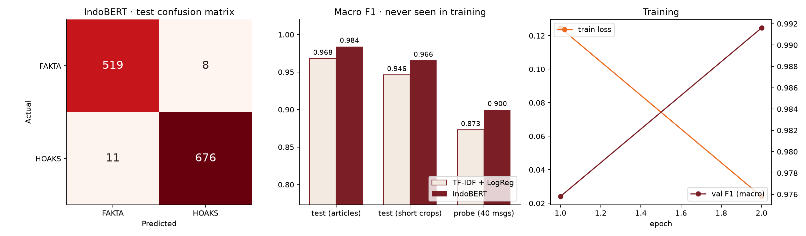

# MarketShield models

Two models, trained and evaluated in this folder. Every number below comes from the JSON files in `results/` and can be reproduced with the commands shown.

| Model | Task | Headline result (held-out test) | Files |
|:-|:-|:-|:-|
| **IndoBERT hoax filter** | Hoax vs fact for Indonesian text | **98.4 %** accuracy, F1 0.984 (TF-IDF baseline 96.9 %); **90 %** on 40 short WhatsApp-style disaster messages | `train_hoax.py`, `results/hoax_*` |
| **Satellite risk engine** | Thermal activity at a volcano in the next 7 days from Earth Engine signals | **ROC-AUC 0.899** vs persistence baseline 0.784; PR-AUC 0.674 vs 0.455; recall 78 % vs 63 % | `risk_engine.py`, `results/risk_*` |

## 1. IndoBERT hoax filter

**Data.** [`mzuama/IndonesianHoaxdetection`](https://huggingface.co/datasets/mzuama/IndonesianHoaxdetection) on Hugging Face: 12,150 Indonesian texts (hoax = 1, fact = 0), lower-cased and stripped of punctuation by the author. Licence not stated on the dataset card.

**Method.**

1. Remove empty texts and **duplicates before splitting** (12,136 left: 6,866 hoax, 5,270 fact), so no text is in both train and test.
2. Stratified split 80 / 10 / 10 with a fixed seed: 9,708 train, 1,214 validation, 1,214 test.
3. Baseline: TF-IDF (word 1–2 grams) + logistic regression.
4. Fine-tune `indobenchmark/indobert-base-p1`, 2 epochs, max length 128, batch 32, lr 3e-5, best epoch on validation. Test split used once.

**Results (final run).**

| Evaluation set | n | TF-IDF + LogReg | **IndoBERT** |
|:-|:-:|:-:|:-:|
| Test (article-length texts) | 1,214 | 96.9 % | **98.4 %** (F1 0.984) |
| Test, short crops (first 8–30 words) | 1,208 | 94.8 % | **96.6 %** |
| Test, disaster-related subset | 70 | 98.6 % | **100 %** |
| Probe: short WhatsApp-style disaster messages | 40 | 87.5 % | **90.0 %** |

Confusion matrix on the test split: 519 facts correct, 8 facts flagged as hoax, 11 hoaxes missed, 676 hoaxes caught.

**How we got there (all runs kept in `results/run*`).**

| Run | Change | Test | Probe (40 short messages) |
|:-|:-|:-:|:-:|
| 1 | Plain fine-tuning | 98.3 % | **50 %**: labelled every short message as hoax |
| 2 | + short-crop augmentation of every training text | 98.5 % | 70 % |
| 3 | + 60 short disaster messages written by the team (training only) | 98.4 % | **90 %** |

Run 1 looked excellent on the test split but failed on the product's real input: the dataset is article-length, chain messages are short. We caught this with a probe set before shipping and fixed it with augmentation. The probe set (`data/probe_short_messages.csv`, 20 official-style, 20 hoax-style) and the training-only domain set (`data/domain_short_messages.csv`, different events and wording, zero overlap with the probe) were both written by the team; treat the probe score as a sanity check, not a benchmark.

**Run it.** `pip install -r requirements.txt && python train_hoax.py --epochs 2 --crop-aug --domain-aug --out results` (about 21 minutes on an Apple M5 GPU; ~10 minutes on a Colab T4). Or open [`hoax_classifier.ipynb`](hoax_classifier.ipynb) in Colab.

**In the product.** The API's `/signals/check` still uses the rule-based classifier `web/src/lib/classify.ts` (a 500 MB model does not fit a serverless function); the fine-tuned model is the next step behind the same contract.

## 2. Satellite risk engine

**Target.** Whether NASA FIRMS records at least one thermal hotspot within 5 km of the summit in the **next 7 days**. PVMBG's alert-level history is not available in machine-readable form, so we use this objective satellite proxy that anyone can recompute. It is **not** the official PVMBG level; the app always shows the official level separately.

**Features** (Google Earth Engine, weekly, for the 25 volcanoes in `data/volcanoes.json`, Jan 2019 – Oct 2026 → 10,067 volcano-weeks):

| Feature | Source |
|:-|:-|
| Hotspot fraction within 5 km this week and in the previous 3 weeks | `FIRMS` |
| SO₂ column within 20 km this week, and its ratio to the previous 3 weeks | `COPERNICUS/S5P/OFFL/L3_SO2` |
| VV backscatter change within 10 km, last 12 days vs 24 days before | `COPERNICUS/S1_GRD` |
| Rainfall within 10 km this week | `NASA/GPM_L3/IMERG_V07` |

**Method.** XGBoost (300 trees, depth 4, class-weighted). **Time split**: train 2019–2023 (6,416 rows), test 2024–2026 (3,651 rows), so the model never sees the future. Compared with a persistence baseline ("next week looks like this week"). SHAP values computed with `TreeExplainer`.

**Results (test 2024–2026).**

| Metric | XGBoost | Persistence baseline |
|:-|:-:|:-:|
| ROC-AUC | **0.899** | 0.784 |
| PR-AUC | **0.674** | 0.455 |
| Recall | **78 %** | 63 % |
| Precision | 55 % | 63 % |
| F1 | **0.649** | 0.633 |
| Onset weeks (no hotspot this week): ROC-AUC / recall | **0.81 / 45 %** | cannot predict onsets |

SHAP ranking: past hotspots (3 weeks) › hotspots this week › SO₂ › rainfall › Sentinel-1 backscatter › SO₂ trend.

**Run it.** Needs an Earth Engine–registered Google Cloud project and `gcloud auth application-default login --scopes=https://www.googleapis.com/auth/earthengine,https://www.googleapis.com/auth/cloud-platform`. Then `python risk_engine.py --project <your-project> --out results` (≈10 minutes to pull 407 weeks × 25 volcanoes). `results/risk_latest.json` holds the newest forecast per volcano; `web/scripts/publish-forecast.ts` writes it to Firestore (`volcanoes/{id}.forecast`), where the console and `/api/v1/volcanoes/{id}/risk` read it.

## Limitations

- The hoax dataset is news-style and its labels come from the dataset author; real WhatsApp messages are shorter and messier. More real, consented, anonymised chain messages are the main way to improve.
- The risk target is a satellite proxy for eruptive activity, not the PVMBG alert level. With machine-readable level history the same pipeline can be retrained on official escalations.
- Earth Engine coverage has gaps (clouds for optical, revisit time for Sentinel-1); missing values are filled with zero.
